# Bird Engine Documentation

Welcome to the official documentation for **Bird Engine**, a modular, high-performance C++ game engine designed for cross-platform 3D and 2D rendering, extensible scene architectures, and a decoupled user-interface subsystem.

Like Godot, Bird Engine prioritizes developer ergonomics, clean separation of concerns, and rapid iteration.

---

## Documentation Roadmap

```mermaid
flowchart TD
    Start["Bird Engine Documentation"] --> GS["Getting Started"]
    Start --> Tut["Step-by-Step Tutorials"]
    Start --> Arch["Architecture Deep Dives"]

    GS --> GS1["1. Engine Introduction"]
    GS --> GS2["2. Building from Source"]
    GS --> GS3["3. Project & Plugin Setup"]

    Tut --> T1["Tutorial 1: Your First 3D Scene"]
    Tut --> T2["Tutorial 2: Camera & Input Handling"]
    Tut --> T3["Tutorial 3: UI Layouts & Widgets"]
    Tut --> T4["Tutorial 4: Shaders & Asset Baking"]
    Tut --> T5["Tutorial 5: Rigid-Body Physics"]
    Tut --> T6["Tutorial 6: Scripting Games in Dart"]

    Arch --> A1["Application Lifecycle & Main Loop"]
    Arch --> A2["Memory & Ownership Model"]
    Arch --> A3["Scene Tree & Scripting"]
    Arch --> A4["Multi-Backend Rendering Pipeline"]
    Arch --> A5["2D Retained-Mode UI Framework"]
    Arch --> A6["Resource & Asset Management"]
    Arch --> A7["Physics (Jolt Integration)"]
    Arch --> A8["Dart Scripting & FFI Codegen"]
    Arch --> A9["Scene Serialization, Prefabs & Save Games"]
    Arch --> A10["Event & Messaging System"]
    Arch --> A11["Diagnostics (Logging, Profiling & Crash Handling)"]
```

---

## Sections

### 1. [Getting Started](getting_started/introduction.md)
Essential guides for downloading, compiling, and configuring Bird Engine on your machine.
- **[Introduction](getting_started/introduction.md)**: Engine philosophy, dynamic library architecture, and feature overview.
- **[Building from Source](getting_started/building_from_source.md)**: Platform prerequisites (Linux, Windows, macOS), CMake options, asset baking, and running test suites.
- **[Building for Android](getting_started/building_for_android.md)**: Getting the APK from GitHub Actions, local Gradle builds, and how the Android app is assembled.
- **[Building for the Web](getting_started/building_for_web.md)**: The WebGL 2 build with Emscripten: getting it from GitHub Actions, building locally, and browser-specific behaviour.
- **[Project Setup](getting_started/project_setup.md)**: How to create a game or application as a dynamic library plugin (`.so`, `.dll`, `.dylib`) and boot it with the Bird runtime.

### 2. [Step-by-Step Tutorials](tutorials/01_first_3d_scene.md)
Hands-on walkthroughs introducing engine systems progressively with complete, runnable code examples.
- **[Tutorial 1: Your First 3D Scene](tutorials/01_first_3d_scene.md)**: Setting up the root Scene, loading 3D models (`MeshComponent`), and manipulating spatial transforms.
- **[Tutorial 2: Camera & Input Handling](tutorials/02_camera_and_input.md)**: Subclassing `ProcessScript<Camera>`, binding input actions, and implementing a smooth free-look camera controller.
- **[Tutorial 3: Building UI Layouts](tutorials/03_building_ui_layouts.md)**: Crafting responsive 2D interfaces with `UIManager`, `UIStack`, buttons, sliders, text inputs, modal dialogs, lists and trees, the colour picker, and rich inputs.
- **[Tutorial 4: Shaders & Asset Baking](tutorials/04_shaders_and_baking.md)**: Writing Vulkan-compatible GLSL shaders, configuring push constants, baking with `BuildTools`, and material assignment.
- **[Tutorial 5: Rigid-Body Physics](tutorials/05_rigid_body_physics.md)**: Static floors and falling boxes with `RigidBodyComponent`, forces in `physicsProcess`, contact and trigger events, raycast picking, collision layers, and a walking character controller.
- **[Tutorial 6: Scripting Games in Dart](tutorials/06_dart_scripting.md)**: Writing and running full 3D, UI, and physics games in Dart with the embedded Dart VM and auto-generated FFI bindings.

### 3. [Architecture Deep Dives](architecture/lifecycle_and_main_loop.md)
Under-the-hood technical references detailing internal mechanics and design decisions.
- **[Lifecycle & Main Loop](architecture/lifecycle_and_main_loop.md)**: The frame execution sequence, delta timing, matrix dirty-flag caching, and window event polling.
- **[Memory & Ownership Model](architecture/memory_and_ownership.md)**: Memory management via `_own<T>`, `_ref<T>`, and `_weak<T>`, plus lifecycle ownership contracts.
- **[Scene Tree & Scripting](architecture/scene_tree_and_scripts.md)**: Entities (`WorldObject`, `Scene`), component model, and `Script<T>` / `ProcessScript<T>` templating.
- **[Rendering Pipeline](architecture/rendering_pipeline.md)**: Multi-backend rendering (`GLPipeline`, `VKPipeline`), offscreen FBOs, post-processing (FXAA), and UI blending passes.
- **[2D UI Framework](architecture/ui_framework.md)**: The two-pass layout system (measure & arrange), event bubbling, popups and focus, `UIDrawList` batching, and the widget library including virtualized lists and trees, the colour picker, and rich inputs.
- **[Resource Management](architecture/resource_management.md)**: Asset caching in `ResourceManager`, binary `.bird` formats, and `BuildTools` compilation.
- **[Physics](architecture/physics.md)**: Jolt integration: per-scene worlds, the fixed-step loop, transform synchronization, character controllers, main-thread contact and trigger events (characters included), collision layers, queries, joints, render interpolation, chunked level collision, and cached debug wireframes.
- **[Animation](architecture/animation.md)**: Shared curves, easing and playback clocks; the `AnimationSystem`; UI transitions through `UIAnimator` and the post-layout visual transform; world tweens; and the skeletal runtime with Assimp-based baking.
- **[Event & Messaging System](architecture/event_bus.md)**: Decoupled C++ and Dart publish-subscribe bus (`EventBus` / `Events`), queued ring-buffer vs. immediate synchronous dispatch, variant `EventPayload` conventions, built-in physics/input/animation events, and automatic entity lifecycle cleanup.
- **[Dart Scripting & FFI Codegen](architecture/dart_scripting_and_codegen.md)**: `libclang`-based `DartApiGenerator`, 3-tier C++/C/Dart FFI architecture, Doxygen-to-Dartdoc extraction, ownership rules, embedded `libdart_dll` VM runtime, and troubleshooting.
- **[Scene Serialization, Prefabs & Save Games](architecture/serialization_and_prefabs.md)**: Format-agnostic `Archive` & JSON schema, `ComponentRegistry` reflection, stable `UUID` & `EntityRef` remapping, `PrefabManager` / `InstantiatePrefab(AssetID)`, property delta overrides, and cross-platform `SaveGame` directory resolution.
- **[Diagnostics (Logging, Profiling & Crash Handling)](architecture/diagnostics.md)**: Thread-safe structured logger with console/rotating-file/ring-buffer sinks, Dart logging bridge, Tracy & internal frame/section profiler, native stack traces, OS crash dumps, Dart script error boundary, and graceful fallback assets.
