# Bird Engine Documentation

Welcome to the official documentation for **Bird Engine**, a modular, high-performance C++ game engine designed for cross-platform 3D and 2D rendering, extensible scene architectures, and a decoupled user-interface subsystem.

Like Godot, Bird Engine prioritizes developer ergonomics, clean separation of concerns, and rapid iteration.

---

## Documentation Roadmap

```mermaid
flowchart TD
    Start["Bird Engine Documentation"] --> GS["Getting Started"]
    Start --> Tut["Step-by-Step Tutorials"]
    Start --> Arch["Architecture Deep Dives"]

    GS --> GS1["1. Engine Introduction"]
    GS --> GS2["2. Building from Source"]
    GS --> GS3["3. Project & Plugin Setup"]

    Tut --> T1["Tutorial 1: Your First 3D Scene"]
    Tut --> T2["Tutorial 2: Camera & Input Handling"]
    Tut --> T3["Tutorial 3: UI Layouts & Widgets"]
    Tut --> T4["Tutorial 4: Shaders & Asset Baking"]

    Arch --> A1["Application Lifecycle & Main Loop"]
    Arch --> A2["Memory & Ownership Model"]
    Arch --> A3["Scene Tree & Scripting"]
    Arch --> A4["Multi-Backend Rendering Pipeline"]
    Arch --> A5["2D Retained-Mode UI Framework"]
    Arch --> A6["Resource & Asset Management"]
```

---

## Sections

### 1. [Getting Started](getting_started/introduction.md)
Essential guides for downloading, compiling, and configuring Bird Engine on your machine.
- **[Introduction](getting_started/introduction.md)**: Engine philosophy, dynamic library architecture, and feature overview.
- **[Building from Source](getting_started/building_from_source.md)**: Platform prerequisites (Linux, Windows, macOS), CMake options, asset baking, and running test suites.
- **[Project Setup](getting_started/project_setup.md)**: How to create a game or application as a dynamic library plugin (`.so`, `.dll`, `.dylib`) and boot it with the Bird runtime.

### 2. [Step-by-Step Tutorials](tutorials/01_first_3d_scene.md)
Hands-on walkthroughs introducing engine systems progressively with complete, runnable code examples.
- **[Tutorial 1: Your First 3D Scene](tutorials/01_first_3d_scene.md)**: Setting up the root Scene, loading 3D models (`MeshComponent`), and manipulating spatial transforms.
- **[Tutorial 2: Camera & Input Handling](tutorials/02_camera_and_input.md)**: Subclassing `ProcessScript<Camera>`, binding input actions, and implementing a smooth free-look camera controller.
- **[Tutorial 3: Building UI Layouts](tutorials/03_building_ui_layouts.md)**: Crafting responsive 2D interfaces with `UIManager`, `UIStack`, buttons, sliders, text inputs, and modal dialogs.
- **[Tutorial 4: Shaders & Asset Baking](tutorials/04_shaders_and_baking.md)**: Writing Vulkan-compatible GLSL shaders, configuring push constants, baking with `BuildTools`, and material assignment.

### 3. [Architecture Deep Dives](architecture/lifecycle_and_main_loop.md)
Under-the-hood technical references detailing internal mechanics and design decisions.
- **[Lifecycle & Main Loop](architecture/lifecycle_and_main_loop.md)**: The frame execution sequence, delta timing, matrix dirty-flag caching, and window event polling.
- **[Memory & Ownership Model](architecture/memory_and_ownership.md)**: Memory management via `_own<T>`, `_ref<T>`, and `_weak<T>`, plus lifecycle ownership contracts.
- **[Scene Tree & Scripting](architecture/scene_tree_and_scripts.md)**: Entities (`WorldObject`, `Scene`), component model, and `Script<T>` / `ProcessScript<T>` templating.
- **[Rendering Pipeline](architecture/rendering_pipeline.md)**: Multi-backend rendering (`GLPipeline`, `VKPipeline`), offscreen FBOs, post-processing (FXAA), and UI blending passes.
- **[2D UI Framework](architecture/ui_framework.md)**: The two-pass layout system (measure & layout), event bubbling, focus navigation, and `UIDrawList` batching.
- **[Resource Management](architecture/resource_management.md)**: Asset caching in `ResourceManager`, binary `.bird` formats, and `BuildTools` compilation.
