# Advanced Skeletal Animation System

Bird Engine's skeletal animation runtime is built around a composable **Pose Evaluation Pipeline** where every node evaluates into a `Pose` (a flat, cache-friendly array of joint-local `JointTransform` translation/rotation/scale structs). Once buffers are warm, the entire pipeline runs with **zero per-frame heap allocations**.

---

## Pose Evaluation Pipeline

Each frame, `SkeletalAnimator::update(delta)` executes seven deterministic stages:

```mermaid
flowchart LR
    P["AnimationParameters<br/>(float / bool / int / trigger)"] --> BASE["1. Base PoseNode<br/>(StateMachine / BlendTree / Clip)"]
    BASE --> LAYERS["2. Animation Layers<br/>(Override & Additive + BoneMask)"]
    LAYERS --> RM["3. Root Motion Extraction<br/>(Delta + Zero Root Offset)"]
    RM --> FK["4. Forward Kinematics<br/>(localToModel)"]
    FK --> IK["5. 2-Bone Analytic IK<br/>(Law of Cosines)"]
    IK --> SKIN["6. Skinning Palette<br/>(buildSkinningPalette mat3x4)"]
    SKIN --> NOTIFY["7. Dispatch Notifies<br/>(AnimationNotifyEvent)"]
```



### Core Types

| Type | Header | Responsibility |
|---|---|---|
| `Pose` / `JointTransform` | `Skeleton.h` | Joint-local TRS array indexed identically to `Skeleton`. |
| `PoseEvalContext` | `PoseNode.h` | Per-frame context (`Skeleton`, `AnimationParameters`, notify queue, `deltaTime`). |
| `PoseNode` | `PoseNode.h` | Abstract base class for all pose generators (`ClipPoseNode`, `BlendTree1D`, `BlendTree2D`, `AnimationStateMachine`). |
| `PoseOps` | `PoseOps.h` | Linear-pass pose math: `blendPoses` (SLERP), `blendPosesNlerp`, `blendPosesMasked`, `blendPosesWeighted`, `makeAdditivePose`, `applyAdditivePoseMasked`, `localToModel`, `buildSkinningPalette`. |

---

## 1. Cross-Fade Blending

All pose blending functions operate in joint-local TRS space:
- **Translation & Scale:** Linear interpolation (`LERP`).
- **Rotation:** Shortest-path spherical linear interpolation (`SLERP`) via `Interpolator<Quaternion>`, or fast normalized linear interpolation (`NLERP`) via `blendPosesNlerp()`. Both check `glm::dot(from, to) < 0.0f` and negate the target quaternion when needed so rotations never take the long arc around the hypersphere.

Cross-fades are supported both on direct playback (`SkeletalAnimator::crossFade`) and automatically on every `AnimationStateMachine` transition.

---

## 2. Animation State Machine & Parameter Blackboard

`AnimationStateMachine` implements `PoseNode`, so it can serve as the animator's root node or live inside an independent upper-body layer.

- **States:** Each named state owns any `PoseNode` (`ClipPoseNode`, `BlendTree1D`, `BlendTree2D`, or a nested `AnimationStateMachine`) and a per-state speed multiplier.
- **Transitions:** Directed edges (`fromState` -> `toState`, or empty `fromState` for **Any-State** transitions) with:
  - `duration`: cross-fade time in seconds (`0.0f` for an instant cut).
  - `hasExitTime` / `exitTime`: normalized source state progress in `[0, 1]` required before transitioning.
  - `priority`: higher-priority transitions are evaluated first.
  - `conditions`: list of `TransitionCondition` predicates (`FloatGreater`, `FloatLess`, `IntEqual`, `BoolTrue`, `BoolFalse`, `Trigger`).
- **Per-Entity Blackboard (`AnimationParameters`):** Stores `float`, `bool`, `int32_t`, and one-shot `trigger` values. Triggers are consumed automatically when a transition referencing them fires.

```cpp
auto sm = std::make_shared<bird::AnimationStateMachine>();
sm->addState("Locomotion", locomotionTree);
sm->addClipState("Attack", attackClip, bird::LoopMode::Once);
sm->addClipState("Hurt", hurtClip, bird::LoopMode::Once);
sm->setEntryState("Locomotion");

// Triggered transition with 0.1s cross-fade
sm->addTransition({"Locomotion", "Attack", 0.1f, false, 1.0f, 0, false,
                   {bird::TransitionCondition::trigger("attack")}});

// Exit-time return to locomotion at 85% completion
sm->addTransition({"Attack", "Locomotion", 0.15f, true, 0.85f, 0, false, {}});

// High-priority Any-State interrupt
sm->addTransition({"", "Hurt", 0.05f, false, 1.0f, 10, false,
                   {bird::TransitionCondition::trigger("hurt")}});

animComponent->setRootNode(sm);
```

---

## 3. 1D & 2D Blend Trees

### 1D Blend Tree (`BlendTree1D`)
Blends between clips sorted along a single float parameter (e.g., `"speed"`). Values below the lowest threshold clamp to the first clip; values above the highest clamp to the last; intermediate values linearly blend the two bracketing clips.

```cpp
auto locomotion = std::make_shared<bird::BlendTree1D>("speed", /*syncNormalizedTime=*/true);
locomotion->addClip(idleClip, 0.0f);
locomotion->addClip(walkClip, 2.0f);
locomotion->addClip(runClip, 6.0f);
```

When `syncNormalizedTime` is enabled (default), active clips advance on a shared `[0, 1]` normalized phase computed from their weighted duration so footsteps stay in phase during transitions.

### 2D Blend Tree (`BlendTree2D`)
Blends directional clips placed on a 2D plane driven by two float parameters (e.g., `"moveX"`, `"moveY"`). Two weighting modes are supported:
- **`BlendTree2DMode::InverseDistance`** (default): Shepard's inverse-distance weighting (`1 / d^p`, configurable via `setIdwPower()`) with an exact-match fast path when landing directly on a sample coordinate.
- **`BlendTree2DMode::Barycentric`**: Finds the smallest-perimeter containing triangle and blends its three vertices with exact barycentric coordinates `(u, v, w)`, clamping to the nearest edge or vertex outside the convex hull.

```cpp
auto strafe = std::make_shared<bird::BlendTree2D>(
    "moveX", "moveY", bird::BlendTree2DMode::Barycentric);
strafe->addClip(idleClip,  { 0.0f,  0.0f});
strafe->addClip(fwdClip,   { 0.0f,  1.0f});
strafe->addClip(backClip,  { 0.0f, -1.0f});
strafe->addClip(leftClip,  {-1.0f,  0.0f});
strafe->addClip(rightClip, { 1.0f,  0.0f});
```

---

## 4. Bone Masking & Animation Layering

`BoneMask` holds a per-joint weight array in `[0.0, 1.0]`. Because `Skeleton` is topologically ordered, `BoneMask::fromBranch(skeleton, "Spine1", 1.0f)` masks a joint and all of its descendants in a single O(joints) pass.

`SkeletalAnimator` supports an ordered stack of `AnimationLayer` entries composited over the base pose:
- **`LayerBlendMode::Override`**: Replaces joint transforms using `blendPosesMasked()` with effective weight `mask[j] * layer.weight`. Ideal for upper-body aiming or reloading over lower-body running.
- **`LayerBlendMode::Additive`**: Computes a delta pose (`target - reference`) via `makeAdditivePose()` and applies it on top of the accumulated pose via `applyAdditivePoseMasked()`. If `layer.referencePose` is empty, the skeleton's rest pose is used as the reference. Ideal for breathing, recoil kicks, or hit flinches.

```cpp
bird::AnimationLayer upperBody;
upperBody.name = "UpperBodyAim";
upperBody.source = std::make_shared<bird::ClipPoseNode>(aimClip, bird::LoopMode::Loop);
upperBody.mask = bird::BoneMask::fromBranch(*skeleton, "Spine1", 1.0f);
upperBody.blendMode = bird::LayerBlendMode::Override;
upperBody.weight = 1.0f;
animComponent->addLayer(std::move(upperBody));

bird::AnimationLayer recoil;
recoil.name = "Recoil";
recoil.source = std::make_shared<bird::ClipPoseNode>(recoilClip, bird::LoopMode::Once);
recoil.blendMode = bird::LayerBlendMode::Additive;
recoil.weight = 0.75f;
animComponent->addLayer(std::move(recoil));
```

---

## 5. Animation Events (Notifies)

Timestamped `AnimationNotify` records (`time`, `name`, optional `payload`) can be attached directly to any `SkeletalClip` (or via `SkeletalAnimationComponent::addClipNotify()`).

During playback, `SkeletalClip::collectNotifies()` detects every notify crossed between `prevTime` and `currTime`, handling:
- First-frame `t == 0.0f` notifies,
- Forward loop wrap-around (`(prevTime, duration]` followed by `[0, currTime]`), and
- Backward playback and backward wrap-around.

Notifies are queued during pose evaluation and dispatched **after** FK, IK, and skinning palette construction complete, so callbacks can safely inspect final joint matrices or trigger new states:

```cpp
animComponent->addClipNotify("Run", 0.25f, "FootstepLeft", "gravel");
animComponent->addClipNotify("Run", 0.75f, "FootstepRight", "gravel");
animComponent->setOnNotify([](const bird::AnimationNotifyEvent& ev) {
    // Forward directly into your audio or engine Event System:
    if (ev.eventName == "FootstepLeft" || ev.eventName == "FootstepRight") {
        playFootstepSound(ev.payload);
    }
});
```

---

## 6. 2-Bone Analytic IK & Root Motion

### 2-Bone Analytic IK (`TwoBoneIK`)
`solveTwoBoneIK()` solves a 3-joint chain (`rootJoint -> midJoint -> endJoint`) analytically using the **Law of Cosines**, running after `localToModel()` and before `buildSkinningPalette()`.

- Clamps unreachable targets cleanly to `[|L1 - L2| + eps, L1 + L2 - eps]`.
- Uses an optional model-space `polePosition` hint to control knee/elbow bend direction (falling back to the FK bend plane when disabled or collinear).
- Blends smoothly between FK and IK via `constraint.weight` in `[0.0, 1.0]`.

```cpp
bird::TwoBoneIKConstraint leftFoot;
leftFoot.name = "LeftFoot";
leftFoot.rootJoint = animComponent->findJoint("LeftUpLeg");
leftFoot.midJoint  = animComponent->findJoint("LeftLeg");
leftFoot.endJoint  = animComponent->findJoint("LeftFoot");
leftFoot.polePosition = bird::Vector3(0.0f, 0.5f, 1.0f);
animComponent->addIKConstraint(leftFoot);

// Each frame, after raycasting the terrain in model space:
animComponent->setIKTarget("LeftFoot", terrainHitModelPos, 1.0f);
```

### Root Motion Extraction (`RootMotionExtractor`)
When enabled via `RootMotionConfig`, the animator computes the per-frame translation delta (and optional yaw rotation delta) of `rootJoint`, handles loop wrap-arounds without backward spikes, and resets the extracted axes in `localPose.joints[rootJoint]` back to the rest pose so the skinned mesh never drifts away from its entity origin.

- **Automatic WorldObject movement:** Call `animComponent->setAutoApplyRootMotion(true)` (or call `applyRootMotionToOwner()` manually).
- **CharacterControllerComponent integration:** Read `animComponent->getRootMotionTranslation()` each frame, rotate by the character's world orientation, divide by `delta`, and pass it to `CharacterControllerComponent::setMoveVelocity()`.

---

## 7. Debug Visualization

`SkeletalDebugDraw` uses the engine's existing 3D `DebugDrawList` (`GraphicsPipeline::getDebugDraw()`) to render:
- Skeleton bone segments connecting every child joint to its parent (`drawBones`),
- Optional local RGB XYZ joint axes (`drawJointAxes`), and
- Wireframe boxes, crosses, and pole guide lines for every enabled 2-Bone IK constraint (`drawIKTargets`).

```cpp
animComponent->setDebugDraw(true);
animComponent->getDebugSettings().drawJointAxes = true;
```

---

## 8. Driving Animations from Dart Scripts

`AnimationParameters`, `AnimationNotify`, `BoneMask`, `TwoBoneIKConstraint`, `RootMotionConfig`, `SkeletalDebugSettings`, and `SkeletalAnimationComponent` are exported through `DartApiGenerator`. Dart scripts can update blackboard parameters, IK targets, root motion, and debug overlays every frame:

```dart
class PlayerController extends BirdScript {
  final SkeletalAnimationComponent anim;
  final CharacterControllerComponent controller;

  PlayerController(this.anim, this.controller);

  @override
  void init() {
    anim.addClipNotify('Run', 0.25, 'Footstep', 'grass');
    anim.setOnNotify((event) {
      print('Notify ${event.eventName} (${event.payload}) at ${event.time}s');
    });
    anim.setRootMotionEnabled(true, 0);
    anim.setDebugDraw(true);
  }

  @override
  void process(double delta) {
    final vel = controller.getVelocity();
    final horizontalSpeed = Vector2(vel.x, vel.z).length;

    // Drive Blend Trees and State Machine transitions
    anim.setFloat('speed', horizontalSpeed);
    anim.setFloat('moveX', inputMoveX);
    anim.setFloat('moveY', inputMoveY);
    anim.setBool('grounded', controller.isOnGround());

    if (input.isKeyPressed(KEY_SPACE)) {
      anim.setTrigger('jump');
    }

    // Consume extracted root motion delta for physics movement
    if (delta > 0.0) {
      final rm = anim.getRootMotionTranslation();
      controller.setMoveVelocity(Vector3(rm.x / delta, 0.0, rm.z / delta));
    }

    // Update foot IK target dynamically
    anim.setIKTarget('LeftFoot', leftFootModelTarget, 1.0);
  }
}
```
