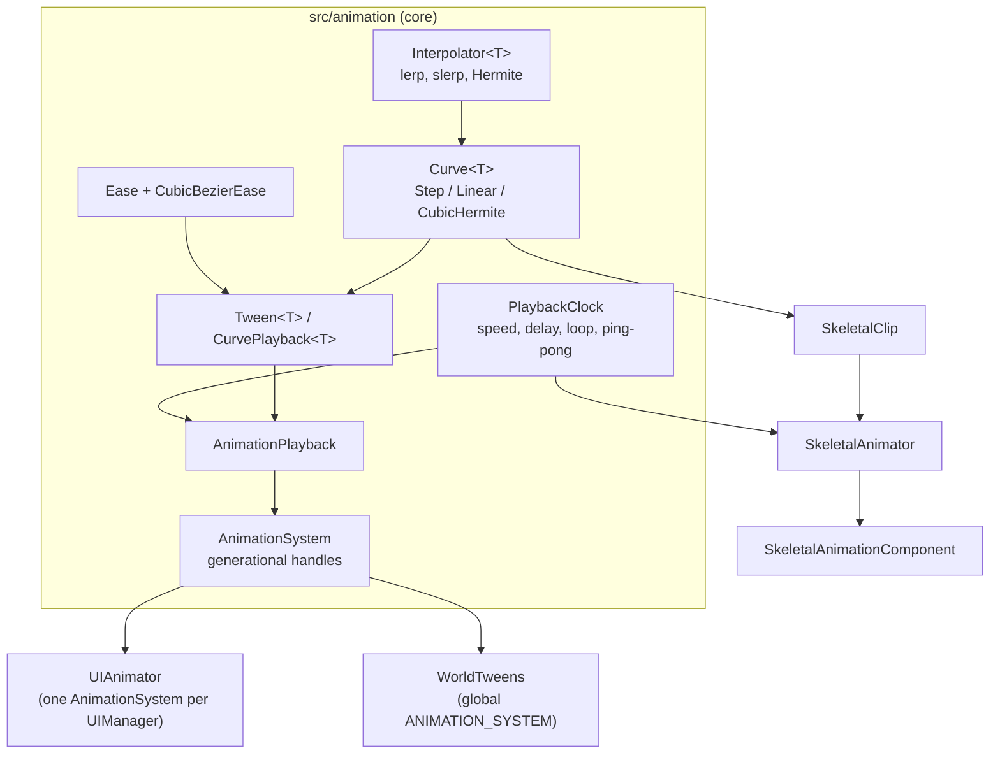

# Animation

Bird Engine animates everything (UI widgets, world transforms, skinned characters, arbitrary script values) with one shared tool set. Specialised systems are thin layers over that tool set rather than separate engines.



## Core building blocks

| Type | Responsibility |
|---|---|
| `Interpolator<T>` | How a type blends. Vector types use component arithmetic; `Quaternion` uses shortest-arc slerp and a normalized Hermite spline. Factors are never clamped, so overshooting easings work. |
| `Ease`, `CubicBezierEase` | The Penner easing set, plus CSS `cubic-bezier()` timing for designer-specified curves. |
| `Curve<T>` | Sorted keyframes sampled at any time. `sample(t, cursor)` is amortized O(1) during forward playback, O(log k) after a seek. Sampling an empty curve throws. |
| `PlaybackClock` | Pure time: speed (negative plays backward), start delay, `LoopMode::Once / Loop / PingPong`, pause. It *reports* events instead of firing callbacks. |
| `AnimationPlayback` | A clock plus `apply(time)`. `step()` advances, applies, **then** notifies, so `onFinished` always observes the final value. |
| `AnimationSystem` | Owns running playbacks in a slot map. Handles are generational and never dangle. Callbacks may play or cancel during `tick()`; new animations start next tick and cancelled ones are destroyed after the tick. |

Script-facing curve types (`FloatCurve`, `Vector2Curve`, `Vector3Curve`, `Vector4Curve`, `QuaternionCurve`) wrap `Curve<T>` because the Dart generator cannot bind templates. Each shares its curve, so one authored curve can drive many playbacks.

## Frame order

`Application::run()` ticks the global `ANIMATION_SYSTEM` after process scripts and before `processScene()` updates matrices. Animation therefore wins over script-written transforms for that frame. Each `UIManager` ticks its own system inside `process()`, before layout.

## World animation

```cpp
tweenLocalPosition(door, Vector3(0, 3, 0), 0.8f, Ease::InOutCubic);
ANIMATION_SYSTEM->tweenFloat(0.0f, 1.0f, 2.0f, Ease::Linear,
                             [light](float v) { light->setIntensity(v); });
```

World tweens register their `WorldObject` as owner; `~WorldObject` cancels them, so a destroyed object is never written to.

## UI animation

`UIObject` has a post-layout **visual transform**: `setVisualOffset`, `setVisualScale`, `setVisualRotation`, `setVisualOrigin` (default centre) and `setOpacity` (multiplied through the subtree). Changing these recomposes transforms and redraws, but never re-measures the tree. Hit testing follows the visual transform.

```cpp
dialog->animate()
    .opacity(0.0f, 1.0f)
    .scale(0.92f, 1.0f)
    .duration(0.18f)
    .ease(Ease::OutBack)
    .onFinished([] { /* ... */ })
    .start();
```

* Omitted start values are read from the node at `start()`.
* A newer transition on a property takes that property over, while the older transition keeps any properties it still owns (claim stamps, O(1)).
* Removing a node cancels every transition in its subtree.
* A detached node snaps to the final values (it has no frames).
* `value(from, to, setter)` animates widget-specific state; `UIToggle` uses it for its knob.

`UIManager::animate(node)` and `UIObject::tick()` remain for timers and hand-written logic (the submenu open delay in `UIMenuPanel` is one).

## Skeletal animation

Pipeline per frame, each stage one linear pass with no allocation once warm:

```
SkeletalClip::sample -> blendPoses (crossfade) -> localToModel -> buildSkinningPalette
```

* `Skeleton` stores joints in topological order (`addJoint` enforces it), so model-space conversion needs no recursion.
* `SkeletalClip` holds per-joint `Curve<Vector3>` / `Curve<Quaternion>` channels; empty channels keep the rest value.
* `SkeletalAnimator` plays one clip plus an optional fading clip, using the same `PlaybackClock` as everything else.
* `SkeletalAnimationComponent` is a `ProcessScriptComponent` that loads `<model>.skel.bird` and exposes `play`, `crossFade`, `stop`, `setSpeed`, `getClipNames` and `getJointModelMatrix`.
* The skinning palette is `model * inverseBind` packed as three rows (`mat3x4`, 48 bytes per joint). In GLSL: `vec3 p = vec4(position, 1.0) * palette[joint];`. `Skeleton::kMaxJoints` is 256, which fits the 16 KB uniform-block minimum guaranteed by OpenGL ES.

### Baking

`BuildTools` imports models through Assimp, so any format Assimp reads is supported. When a model has bones, it is imported without `aiProcess_PreTransformVertices` (which would discard the hierarchy), and `<model>.skel.bird` is written alongside the usual mesh bake. The file holds the skeleton (bones, animated nodes and all ancestors, so armature transforms survive), every clip (converted from ticks to seconds), and per-mesh skin streams (four strongest influences, renormalized). The reader validates every count and index and throws on malformed files.

Known limitations:

* Assimp 5.3 does not report per-key interpolation, so clips import as linear.
* Static meshes inside a skinned file are not pre-transformed.

### GPU skinning

Rendering is linear blend skinning in the vertex stage, on every backend target the baker emits (GLSL 4.10 and 4.60), with nothing desktop-only, so the same design carries to OpenGL ES and WebGL.

* **Mesh streams.** `ResourceManager::loadMesh` attaches the skin streams from `<model>.skel.bird` to the matching meshes (`Mesh::setSkin`). `GLMesh` exposes joint indices at attribute location 4 as integers (`glVertexAttribIPointer`, `uvec4` in GLSL) and weights at location 5.
* **Palette block.** `GLSkinningBlock` owns uniform block 4 (`SkinningUBOData`, 256 `mat3x4` entries, 12 KB). It re-uploads only when the palette differs from the last one uploaded this frame, so a character's meshes and its G-buffer, forward and shadow draws share one upload.
* **Programs.** Each pass holds a `GLMeshPrograms` pair: the rigid program and its skinned twin (`mesh_skinned.vert`, `shadow_depth_skinned.vert`) behind the same fragment stage and push constants. `prepare(item)` switches programs only when needed; the render queue sorts rigid draws before skinned ones, so each pass switches at most once.
* **Shaders.** `include/mesh_vertex.glsl` holds the vertex interface shared by `mesh.vert` and `mesh_skinned.vert`; `include/skinning.glsl` blends the four joint rows and transforms points and directions.
* **Culling.** A skinned draw's bounds come from `skinnedBounds`: a sphere around every influencing joint, with the radius measured at load (`computeJointRadii`) and scaled by the joint's current scale. Linear blend skinning keeps each vertex inside the convex hull of its joints' rigid copies, so the box always contains the posed mesh.
* **Fallback.** A skinned mesh on an object without a `SkeletalAnimationComponent` draws with the rigid program, in its bind pose.

Future work: a ring of palette blocks (or one large block addressed by offset) to avoid re-specifying a single buffer between draws, and dual quaternion skinning for volume-preserving twists.
