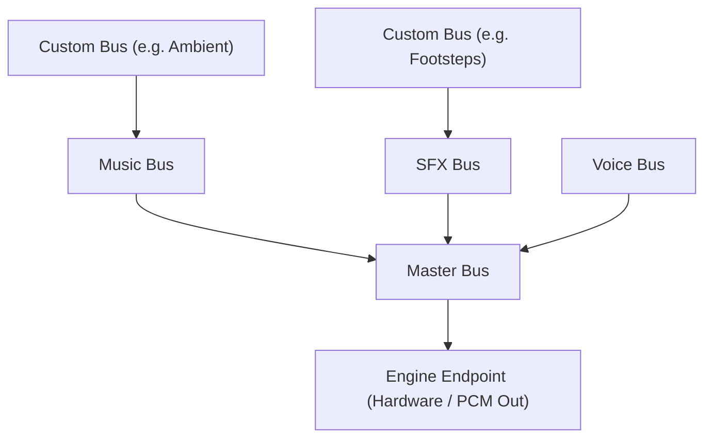

# Audio System

Bird Engine provides a lightweight, cross-platform audio subsystem in [`src/audio/`](../../src/audio/) built on the single-header [`miniaudio`](https://miniaud.io) library (`ma_engine` and its node-graph API). It ships with zero heavy external dependencies and supports WAV, MP3, and FLAC playback out of the box across Desktop (Linux, Windows, macOS), Android, and Web.

---

## Encapsulation & Module Boundaries

All `miniaudio` types and headers are strictly confined to `src/audio/`:

- `src/audio/third_party/miniaudio.h` and `src/audio/MiniaudioImpl.cpp` compile the backend once inside the `audio` CMake object library.
- `src/audio/AudioInternal.h` holds `AudioSystem::Impl` (the PIMPL struct containing `ma_engine`, `ma_sound_group` bus nodes, and active `ma_sound` slots) and is excluded from installed public headers.
- Public headers (`AudioTypes.h`, `AudioSystem.h`, `AudioSourceComponent.h`, `AudioListenerComponent.h`) expose only Bird Engine types (`Vector3`, `AudioHandle`, `AudioPlayOptions`, `Audio3DSettings`, etc.). No other engine module ever includes `miniaudio.h`.

### Lifecycle & Headless Fallback

`Application::start()` creates and initializes the global `AUDIO_SYSTEM` singleton before loading the root `Scene`, ticks it every frame in `Application::tick()` after scene transforms and physics interpolation settle, and destroys it after `delete m_scene` in `Application::deinit()`.

If opening a hardware playback device fails (for example on a headless CI host without PulseAudio/ALSA), `AudioSystem::init()` automatically logs a warning and falls back to **no-device mode** (`ma_engine_config::noDevice = MA_TRUE`). Offline renderers and unit tests can also request `AudioSystemConfig::noDevice = true` explicitly and pull mixed float32 PCM frames via `AudioSystem::readPcmFrames()`.

---

## Hierarchical Mixing Bus Graph

Audio routing is built on `miniaudio`'s node graph (`ma_sound_group` nodes feeding into parent groups and ultimately the engine endpoint):



### Built-In & Custom Buses

Four default buses are created during `AudioSystem::init()` (constants live on `AudioBus`):

| Constant | Bus Name | Parent | Intended Use |
|---|---|---|---|
| `AudioBus::kMaster` | `"Master"` | Engine Endpoint | Global output gain, mute, pause, and pitch |
| `AudioBus::kMusic` | `"Music"` | `"Master"` | Streamed background music and soundtracks |
| `AudioBus::kSFX` | `"SFX"` | `"Master"` | Gameplay sound effects and UI clicks |
| `AudioBus::kVoice` | `"Voice"` | `"Master"` | Dialogue, narration, and character voices |

Custom sub-buses can be created at runtime and nested under any existing bus:

```cpp
AUDIO_SYSTEM->createBus("Footsteps", AudioBus::kSFX);
AUDIO_SYSTEM->createBus("UI", AudioBus::kSFX);
```

### Per-Bus Controls (Settings Menu Ready)

Every bus supports independent controls that compose hierarchically down the graph:

- **Volume** (`setBusVolume` / `getBusVolume`): Linear gain (`>= 0.0`). Stored separately from mute state so unmuting restores the exact configured level.
- **Mute** (`setBusMuted` / `isBusMuted`): Silences the bus and all descendants without modifying stored volume.
- **Pause / Resume** (`setBusPaused` / `isBusPaused`): Stops/starts the `ma_sound_group` node in the graph, freezing all routed sounds and child buses in place until resumed.
- **Pitch** (`setBusPitch` / `getBusPitch`): Composes multiplicatively along the bus ancestry (`Master * parent * bus * sound`) and updates active sounds immediately.

```cpp
AUDIO_SYSTEM->setMasterVolume(0.8f);
AUDIO_SYSTEM->setBusVolume(AudioBus::kMusic, 0.5f);
AUDIO_SYSTEM->setBusMuted(AudioBus::kSFX, false);
AUDIO_SYSTEM->setBusPaused(AudioBus::kSFX, true);  // e.g. when opening pause menu
```

---

## 2D Playback, Streaming & Fades

### Fire-and-Forget One-Shots

Short UI clicks and gameplay impacts are decoded into memory (`MA_SOUND_FLAG_DECODE`) for zero-latency playback and automatically retired by `AudioSystem::tick()` once they finish:

```cpp
AUDIO_SYSTEM->playOneShot("assets/audio/ui_click.wav", AudioBus::kSFX, 0.9f, 1.0f);
```

### Disk-Streamed Music & Ambient Beds

Long tracks should be streamed incrementally from disk (`MA_SOUND_FLAG_STREAM`) rather than fully decoded into RAM. `playMusic()` enables streaming, looping, and routing to `AudioBus::kMusic` automatically:

```cpp
AudioHandle bgm = AUDIO_SYSTEM->playMusic(
    "assets/audio/theme.mp3",
    /*loop=*/true,
    /*fadeInSeconds=*/1.5f,
    /*volume=*/0.7f);
```

For general 2D playback (such as looping ambient beds or panned UI sounds), use `play2D()` with `AudioPlayOptions`:

```cpp
AudioPlayOptions opts;
opts.bus = AudioBus::kMusic;
opts.stream = true;
opts.looping = true;
opts.pan = -0.25f;
opts.fadeInSeconds = 2.0f;
AudioHandle wind = AUDIO_SYSTEM->play2D("assets/audio/wind_loop.wav", opts);
```

### Handle Control & Sample-Accurate Fades

All playback methods return a generational `AudioHandle`. Stale handles safely no-op once their sound has finished or been stopped:

```cpp
AUDIO_SYSTEM->pause(bgm);
AUDIO_SYSTEM->resume(bgm);
AUDIO_SYSTEM->fadeTo(bgm, 0.3f, 0.75f);    // Duck music smoothly
AUDIO_SYSTEM->stopWithFade(bgm, 1.0f);     // Fade to silence, then release
```

---

## 3D Spatialized Playback & Components

Bird Engine and `miniaudio` both use a right-handed coordinate system (`+X` right, `+Y` up, `-Z` forward), so scene transforms map directly to 3D audio without axis conversion.

### `AudioListenerComponent`

Attach `AudioListenerComponent` to the active `Camera` (or player head `WorldObject`). During `Application::tick()`, `AudioSystem::tick(delta)` pushes the host's world position, forward vector (`rotation * (0, 0, -1)`), up vector (`rotation * (0, 1, 0)`), and frame-to-frame velocity `(pos - prevPos) / delta` (for Doppler shift) to the engine's listener:

```cpp
auto listener = _own_mk<AudioListenerComponent>(/*active=*/true);
camera->addComponent(std::move(listener));
```

Only one `AudioListenerComponent` is active at a time. You can also call `AUDIO_SYSTEM->setListenerTransform(...)` directly if you are not using a component.

### `AudioSourceComponent`

Attach `AudioSourceComponent` to any `WorldObject` for a persistent 3D (or 2D) sound source that tracks its host entity every frame:

```cpp
auto source = _own_mk<AudioSourceComponent>("assets/audio/campfire.wav", AudioBus::kSFX);
source->setSpatialized(true);
source->setLooping(true);
source->setPlayOnInit(true);
source->setAttenuationModel(AudioAttenuationModel::Inverse);
source->setMinDistance(1.5f);
source->setMaxDistance(40.0f);
source->setRolloff(1.0f);
source->setDopplerFactor(1.0f);
campfire->addComponent(std::move(source));
```

Supported attenuation curves (`AudioAttenuationModel`):
- `None`: No distance falloff.
- `Inverse` (default): Physically inspired `1 / d` rolloff beyond `minDistance`.
- `Linear`: Linear rolloff between `minDistance` and `maxDistance`.
- `Exponential`: Exponential rolloff controlled by `rolloff`.

For transient 3D sounds (explosions, footsteps), use `playOneShot3D()` or `play3D()`:

```cpp
AUDIO_SYSTEM->playOneShot3D("assets/audio/explosion.wav", Vector3(12.0f, 0.0f, -8.0f));
```

---

## Dart Scripting API

The audio headers are registered in `BIRD_SCRIPT_HEADERS` (`src/dart/CMakeLists.txt`), so `DartApiGenerator` automatically exposes the full audio API and the `audioSystem` global singleton to Dart scripts.

### Bus Controls (Settings Menu)

```dart
import 'package:bird_engine/bird_engine.dart';

void applyAudioSettings({
  required double master,
  required double music,
  required double sfx,
  required double voice,
  required bool muted,
}) {
  final audio = audioSystem;
  if (audio == null) return;

  audio.setMasterVolume(master);
  audio.setMasterMuted(muted);
  audio.setBusVolume(AudioBus.kMusic, music);
  audio.setBusVolume(AudioBus.kSFX, sfx);
  audio.setBusVolume(AudioBus.kVoice, voice);
}
```

### 2D, Streamed Music & 3D Playback from Dart

```dart
import 'package:bird_engine/bird_engine.dart';

void setupSceneAudio(Scene scene, Camera camera) {
  final audio = audioSystem!;

  // Attach 3D listener to the active camera
  camera.addComponent(AudioListenerComponent(true));

  // Stream background music with a 2-second fade-in
  final musicHandle = audio.playMusic('assets/audio/theme.mp3', true, 2.0, 0.6);

  // Fire-and-forget UI click
  audio.playOneShot('assets/audio/click.wav', AudioBus.kSFX, 1.0, 1.0);

  // Persistent 3D audio source attached to a WorldObject
  final beacon = WorldObject();
  beacon.setWorldPosition(Vector3(10.0, 1.0, -5.0));

  final source = AudioSourceComponent('assets/audio/hum.wav', AudioBus.kSFX);
  source.setLooping(true);
  source.setSpatialized(true);
  source.setMinDistance(2.0);
  source.setMaxDistance(35.0);
  source.setPlayOnInit(true);
  beacon.addComponent(source);
  scene.addChild(beacon);

  // Later: fade out music smoothly
  audio.stopWithFade(musicHandle, 1.5);
}
```
