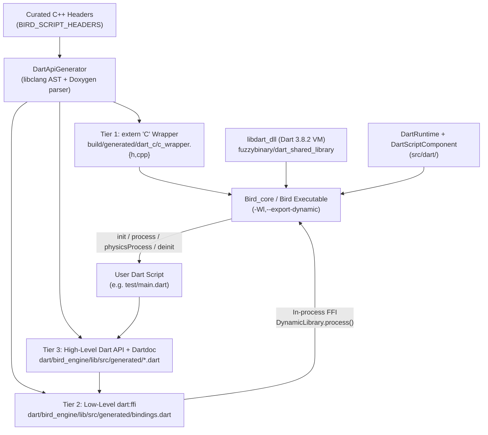

# Dart Scripting & Automatic FFI Binding Generator

Bird Engine embeds the **Dart VM** directly inside the single `Bird` executable and automatically generates a complete, documented Dart API from the engine's C++ headers at build time.

---

## Architecture Overview



### Three-Tier Code Generation
1. **Tier 1 (`c_wrapper.h`, `c_wrapper.cpp`)**: Flat `extern "C"` functions with `BIRD_C_API` export visibility and POD mirrors (`BVec2`, `BVec3`, `BVec4`, `BQuat`, `BMat3`, `BMat4`, `BInt32List`, `BPtrList`, `BStrList`). Compiled directly into `Bird_core` — no separate wrapper shared library is created.
2. **Tier 2 (`bindings.dart`)**: Low-level `dart:ffi` struct definitions and lazy `lookupFunction` bindings. Resolves symbols in-process via `ffi.DynamicLibrary.process()` when running inside the `Bird` executable, with automatic fallback to `DynamicLibrary.open('libBird_core.{so,dylib,dll}')` for standalone Dart hosts.
3. **Tier 3 (`<class>.dart`, `math.dart`, `enums.dart`, `functions.dart`, `globals.dart`, `input_constants.dart`, `shared_refs.dart`, `native_object.dart`)**: Idiomatic Dart classes mirroring the C++ class hierarchy (`extends`, `@override`), operators, static constants, singletons, and full Dartdoc comments converted from C++ Doxygen comments.

---

## Supported C++ Constructs & Type Mapping

| C++ Type / Feature | `extern "C"` ABI | Dart API Type | Notes |
|---|---|---|---|
| `bool`, `int32_t`, `uint32_t`, `int64_t`, `uint64_t`, `size_t`, `float`, `double` (and `const T&`) | Primitive C type | `bool`, `int`, `double` | `const T&` primitives (e.g. `const float&`) are passed by value. |
| `std::string`, `const std::string&`, `const char*` | `const char*` (param), `char*` (return) | `String` | Returned `std::string` values are duplicated and freed immediately via `bird_string_free`. |
| `Vector2/3/4`, `Quaternion` | `BVec2/3/4`, `BQuat` by value | `Vector2/3/4`, `Quaternion` | Full math operators (`+`, `-`, `*`, `/`, `dot`, `cross`, `conjugate`, `rotate`). |
| `Matrix3`, `Matrix4` | `const BMat*` (param), `BMat* out_result` (return) | `Matrix3`, `Matrix4` | Large matrices use out-pointers to avoid ABI struct-return issues. |
| `enum` / `enum class` | `int32_t` | Dart `enum` with `.value` & `fromValue()` | Preserves explicit enumerator values and docs. |
| `T*`, `T&`, `const T&`, `T` (exported class) | `void*` | `T?` (for `T*`), `T` (for `T&`/`T`) | Raw pointer params and returns are nullable (`T?`). |
| `_own<T>` (`std::unique_ptr<T>`) param | `void*` | `T` | Dart calls `releaseOwnership()` before transferring pointer to C++. |
| `_ref<T>` (`std::shared_ptr<T>`) | `void*` (`std::shared_ptr<T>*`) | `<T>Ref` (`BirdNativeObject`) | Heap-allocated shared pointer handle freed by `NativeFinalizer`. |
| `std::optional<T>` return | `void*` (`nullptr` when empty) | `T?` (`owned: true`) | Used for queries like `PhysicsWorld.raycast()` and `shapeCast()`. |
| `std::vector<int>` / `std::vector<std::string>` | `BInt32List` / `BStrList` | `List<int>` / `List<String>` | Freed immediately after copying to Dart `List`. |
| `std::vector<T*>` / `std::vector<_own<T>>` / `std::vector<T>` / `std::vector<_ref<T>>` | `BPtrList` (return), `(void* const*, int32_t)` (param) | `List<T>` / `List<TRef>` | Preserves ownership semantics per element kind. |
| `std::function<void(Args...)>` | `void*` (function pointer) | `void Function(Args...)` | Backed by `NativeCallable.isolateLocal` + `BirdScopedDartIsolate` in C++. |
| Public fields & `static constexpr` | `*_get_<field>` / `*_set_<field>` | `get` / `set` properties | `const` / `constexpr` fields emit read-only getters (e.g. `UIAlignment.TopLeft`). |
| Global `extern BIRD_API` singletons | `bird_global_<NAME>()` | Top-level getters (`input`, `resourceManager`, `application`) | Borrowed handles (`owned: false`). |
| `#define KEY_*` / `MOUSE_BUTTON_*` / `CURSOR_*` / `ACTION_*` | — | `const int` in `input_constants.dart` | Extracted directly from `Input.h`. |

---

## Documentation Extraction (Doxygen → Dartdoc)

`DartApiGenerator` reads raw comments via `clang_Cursor_getRawCommentText` on every exported class, struct, enum, enumerator, method, constructor, field, free function, and singleton:
- Strips `/** ... */`, `*`, and `///` comment framing while preserving paragraphs.
- Converts `@param name desc` → `/// - [name]: desc`.
- Converts `@return desc` → `/// Returns desc`.
- Converts `@throws Type desc` → `/// Throws \`Type\` desc`.
- Emits comments into both `c_wrapper.h` and every generated `.dart` file so Dart IDEs show full inline API docs.

---

## Exposing New C++ Headers or Excluding Internals

### Adding a Header to the Dart API
Add the header path to `BIRD_SCRIPT_HEADERS` in [`src/dart/CMakeLists.txt`](../../src/dart/CMakeLists.txt):
```cmake
set(BIRD_SCRIPT_HEADERS
    ...
    ${CMAKE_SOURCE_DIR}/src/path/to/MyNewSystem.h
)
```
On the next `cmake --build build`, CMake automatically re-runs `DartApiGenerator`, recompiles `c_wrapper.cpp` into `Bird_core`, and regenerates `dart/bird_engine/lib/src/generated/`.

### Excluding Internal C++ Symbols (`BIRD_NO_EXPORT`)
Include `util/Constants.h` and annotate any internal class, method, or field with `BIRD_NO_EXPORT`:
```cpp
#include "util/Constants.h"

class MySystem {
   public:
    void publicScriptMethod();
    BIRD_NO_EXPORT void internalOnlyMethod();
};
```
During normal C++ compilation, `BIRD_NO_EXPORT` expands to nothing. When `DartApiGenerator` parses headers, it defines `-DBIRD_CODEGEN`, which expands `BIRD_NO_EXPORT` to `__attribute__((annotate("bird_no_export")))` so the generator skips it cleanly.

> [!NOTE]
> C++ methods starting with `_` (such as internal framework hooks `Component::_init()` and `_deinit()`) and C++ operators (`operator==`, etc.) are automatically skipped.

---

## Memory & Ownership Across C++ and Dart

All generated proxy classes inherit from `BirdNativeObject`:
- **Dart-owned (`owned: true`)**: Returned by Dart constructors (`Scene()`, `WorldObject()`, `UIButton('Save')`) and by-value C++ returns. Attaches a `ffi.NativeFinalizer` so Dart GC frees the C++ object if `dispose()` isn't called manually.
- **Borrowed (`owned: false`)**: Returned by C++ raw pointers/references (`getParent()`, `getUIManager()`, `getWorldEnvironment()`, `sceneFromAddress()`). Never attaches a finalizer, preventing double-frees of engine-owned memory.
- **Ownership transfer (`_own<T>`)**: Calling `scene.addChild(entity)`, `entity.addComponent(comp)`, or `parent.addChild(widget)` automatically calls `releaseOwnership()` (detaching Dart's `NativeFinalizer`) before handing the raw pointer to C++'s `std::unique_ptr`.
- **Callbacks**: `std::function` Dart closures are retained via `registerNativeCallback(...)` and should be released on shutdown via `clearNativeCallbacks()` in `appDeinit()`.

---

## Embedded Dart VM Runtime (`src/dart/`)

- **`libdart_dll`**: Provided by [`fuzzybinary/dart_shared_library`](https://github.com/fuzzybinary/dart_shared_library) (v0.2.0, Dart **3.8.2**), fetched automatically by `libs/CMakeLists.txt` (`DART_SHARED_LIB`).
- **`DartRuntime`**: Initializes the embedded VM (`DartDll_Initialize`), auto-discovers `.dart_tool/package_config.json` by walking upward from the script path, loads `.dart` source files or `.dill` kernel snapshots (`DartDll_LoadScript`), and invokes `@pragma('vm:entry-point')` functions.
- **`DartScriptComponent`**: Subclasses `ProcessScriptComponent` and bridges `init()`, `process(delta)`, `physicsProcess(fixedDelta)`, and `deinit()` directly into Dart `NativeCallable.isolateLocal` callbacks, automatically entering/exiting the Dart isolate when called from C++'s main loop.
- **`DartAppScript`**: Used by `src/main.cpp` when `./build/Bird` is passed a `.dart` or `.dill` file. Invokes `appEntry(int sceneAddr)` during `Application::init()` and `appDeinit()` during teardown.

---

## Troubleshooting

- **`dart_shared_library (dart_dll.h) was not found`**:
  Run the dependency build first:
  ```bash
  cmake -S libs -B libs && cmake --build libs --target DART_SHARED_LIB
  ```
- **`libclang` / `LLVM` not found during CMake configure**:
  Install LLVM/Clang development headers on your host (e.g. `sudo apt-get install libclang-dev llvm-dev` on Ubuntu/Debian, `sudo pacman -S clang llvm` on Arch, or `brew install llvm` on macOS).
- **`To invoke '...::appEntry' from native code, it must be annotated`**:
  Every top-level Dart function invoked from C++ (`appEntry`, `appDeinit`) must have `@pragma('vm:entry-point')` directly above it.
- **`Couldn't initialize GLEW!` under Sway / Wayland**:
  Run with `env -u WAYLAND_DISPLAY ./build/Bird test/main.dart` so GLFW uses XWayland/GLX.
