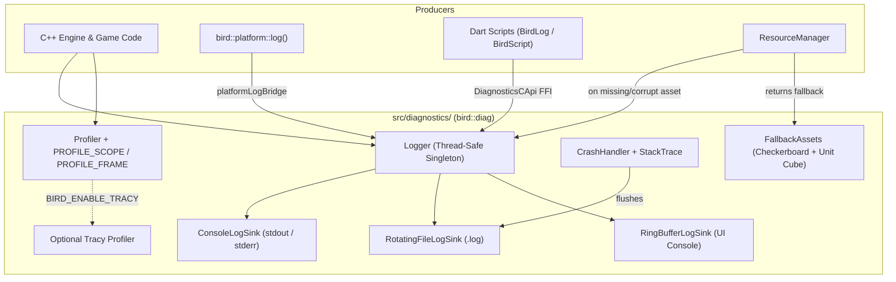

# Diagnostics: Logging, Profiling & Crash Handling

Bird Engine ships a standalone diagnostics module (`src/diagnostics/`) providing structured multi-sink logging, CPU/frame profiling (with optional Tracy integration), native C++ stack traces, OS-level crash handlers, a Dart script error boundary, and graceful fallback assets.

---

## Architecture Overview



---

## CMake Configuration

All diagnostics features are compiled into `Bird_core` via the `diagnostics` object library (`src/diagnostics/CMakeLists.txt`). Optional compile-time flags:

| CMake Option | Default | Effect |
|---|---|---|
| `BIRD_ENABLE_PROFILING` | `ON` | Enables `PROFILE_SCOPE(name)`, `PROFILE_FUNCTION()`, and `PROFILE_FRAME()`. Set to `OFF` (`BIRD_ENABLE_PROFILING=0`) to compile all profiling macros out completely. |
| `BIRD_ENABLE_TRACY` | `OFF` | Links `Tracy::TracyClient` (`find_package(Tracy CONFIG REQUIRED)`) and forwards `PROFILE_SCOPE` / `PROFILE_FRAME` to `ZoneScopedN` / `FrameMark` alongside the internal ring buffer. |
| `BIRD_ENABLE_CPPTRACE` | `OFF` | Links `cpptrace::cpptrace` (`find_package(cpptrace CONFIG REQUIRED)`) for `captureStackTrace()`. When `OFF`, uses platform-native stack walking (`backtrace`/`dladdr`/`__cxa_demangle` on Linux & macOS; `CaptureStackBackTrace`/`DbgHelp` on Windows). |

---

## 1. Structured Logger

### Severity Levels

`bird::diag::LogSeverity` defines six ordered levels:

- `Trace` (`0`) — Fine-grained per-frame or inner-loop tracing
- `Debug` (`1`) — Developer diagnostics
- `Info` (`2`) — Lifecycle milestones and normal status
- `Warn` (`3`) — Recoverable anomalies
- `Error` (`4`) — Failures (auto-flushes all sinks)
- `Fatal` (`5`) — Unrecoverable failures (auto-flushes all sinks)

### Built-in Sinks

1. **`ConsoleLogSink`**: Routes `Trace`/`Debug`/`Info` to `stdout` and `Warn`/`Error`/`Fatal` to `stderr`, with optional ANSI severity coloring.
2. **`RotatingFileLogSink`**: Writes UTC-timestamped lines (`[YYYY-MM-DD HH:MM:SS.mmm] [LEVEL] [Category] message`) to a `.log` file. Automatically rotates `bird.log` -> `bird.1.log` -> `bird.2.log` up to `maxFiles` when `maxFileSizeBytes` is exceeded. Flushes immediately on `Error`, `Fatal`, `flush()`, and shutdown.
3. **`RingBufferLogSink`**: Fixed-capacity in-memory circular buffer (default 2,048 entries) that feeds the engine's custom 2D UI log console with zero unbounded heap growth.

### C++ Usage

```cpp
#include "diagnostics/Logger.h"

void initDiagnostics() {
    bird::diag::LoggerConfig cfg;
    cfg.minSeverity = bird::diag::LogSeverity::Debug;
    cfg.logFilePath = "logs/bird.log";
    cfg.maxFileSizeBytes = 5 * 1024 * 1024;  // 5 MiB per file
    cfg.maxLogFiles = 5;
    cfg.ringBufferCapacity = 2048;
    cfg.bridgePlatformLog = true;            // forwards bird::platform::log()

    bird::diag::Logger::get().init(cfg);
}

void example() {
    BIRD_LOG_INFO("Renderer", "Swapchain created");
    BIRD_LOG_WARN("Physics", "Fixed step accumulator clamped");
    BIRD_LOG_ERROR("Assets", "Failed to open texture");
}
```

#### Reading Logs in a Custom UI Console

```cpp
auto ring = bird::diag::Logger::get().getRingBufferSink();
if (ring) {
    // Incremental polling using sequence numbers:
    static uint64_t lastSeq = 0;
    auto newEntries = ring->snapshotSince(lastSeq);
    for (const auto& rec : newEntries) {
        appendLineToUiConsole(rec.format(), rec.severity);
        lastSeq = rec.sequence;
    }

    // Or filtered snapshot:
    auto errors = ring->snapshotFiltered(bird::diag::LogSeverity::Error, "Dart");
}
```

### Dart Usage

The `bird_engine` package exposes `BirdLog` and `LogSeverity` via `bird_diagnostics.dart`:

```dart
import 'package:bird_engine/bird_engine.dart';

void onPlayerSpawned() {
  BirdLog.info('Gameplay', 'Player spawned at origin');
  BirdLog.warn('Gameplay', 'Low stamina warning');
  BirdLog.error('Gameplay', 'Unexpected null target');
  BirdLog.setMinSeverity(LogSeverity.debug);
}
```

---

## 2. Profiler Integration

### Macros

Include `diagnostics/Profiler.h` and instrument frames and CPU sections:

```cpp
#include "diagnostics/Profiler.h"

void Application::tick() {
    PROFILE_FRAME();
    {
        PROFILE_SCOPE("Physics");
        stepPhysics();
    }
    {
        PROFILE_SCOPE("Render");
        renderScene();
    }
}
```

`Application::tick()` is pre-instrumented with `PROFILE_FRAME()` and top-level scopes (`Physics`, `UI`, `Scripts`, `Animation`, `SceneUpdate`, `Render`, `Present`).

### Rendering an In-Game FPS & Frame-Time Overlay

The internal ring buffer stores the last 240 frames (configurable via `setHistoryCapacity`) without requiring an external profiler:

```cpp
#include "diagnostics/Profiler.h"

void updatePerfOverlay(bird::UILabel* label) {
    const auto stats = bird::diag::Profiler::get().summary(60);
    const auto last = bird::diag::Profiler::get().latestFrame();

    std::string text = "FPS: " + std::to_string(static_cast<int>(stats.averageFps)) +
                       " | Avg: " + std::to_string(stats.averageFrameTimeMs) + " ms" +
                       " | P95: " + std::to_string(stats.p95FrameTimeMs) + " ms\n";
    for (const auto& sec : last.sections) {
        text += std::string(sec.depth * 2, ' ') + sec.name + ": " +
                std::to_string(sec.durationMs) + " ms (" +
                std::to_string(sec.callCount) + "x)\n";
    }
    label->setText(text);
}
```

Dart scripts can also read rolling metrics via `BirdProfiler.averageFps` and `BirdProfiler.lastFrameMs`.

---

## 3. Crash Handling, Stack Traces & Error Boundaries

### OS-Level Crash Handler

`main.cpp` installs `bird::diag::CrashHandler::install()` at startup:

- **Windows**: Installs `SetUnhandledExceptionFilter`, writes a binary `.dmp` via `MiniDumpWriteDump`, writes a readable `.txt` crash report with stack trace, and flushes the active log file.
- **Linux / macOS**: Installs `sigaction` (`SA_RESETHAND`) for `SIGSEGV`, `SIGABRT`, `SIGFPE`, `SIGILL`, and `SIGBUS`, writes an async-signal-safe `.txt` crash report with `backtrace_symbols_fd`, flushes logs, and re-raises the signal.
- **C++ `std::terminate`**: Captures a full `StackTrace`, logs a `FATAL` entry, writes a crash report, and flushes all sinks before aborting.

```cpp
bird::diag::CrashHandlerConfig crashCfg;
crashCfg.dumpDirectory = "crashes";
crashCfg.dumpFilePrefix = "bird_crash";
crashCfg.writeMinidump = true;
crashCfg.flushLogger = true;
bird::diag::CrashHandler::install(crashCfg);
```

### Dart Script Error Boundary

`BirdScript<T>` (`dart/bird_engine/lib/src/bird_script.dart`) and `DartScriptComponent` (`src/dart/DartScriptComponent.cpp`) isolate unhandled exceptions in `init()`, `process()`, `physicsProcess()`, and `deinit()`:

1. When a Dart script throws an unhandled exception, the boundary catches `(error, stackTrace)`, logs both the exception message and full Dart stack trace under category `"DartScript"` at `ERROR` severity, and disables **only that offending script component** (both in Dart and via `bird_DartScriptComponent_disable` in C++).
2. Other script components and the engine loop continue running without crashing.
3. On scene teardown, native callback handles (`NativeCallable`) are still closed cleanly to prevent leaks.
4. `DartRuntime::checkHandleError` also extracts `Dart_ErrorGetException` and `Dart_ErrorGetStackTrace` for top-level Dart invocations (`appEntry`, `appDeinit`) and logs them via `BIRD_LOG_ERROR("Dart", ...)`.

### Graceful Fallback Assets

When `ResourceManager` fails to open or parse an asset (missing `.bird` file, zero channels, truncated data), it logs an `ERROR` under category `"Assets"` and returns a lazily cached fallback instead of crashing:

- **Missing Texture**: 64x64 magenta (`#FF00FF`) / black (`#000000`) checkerboard RGBA8 texture (`generateCheckerboardTextureData` / `createFallbackTexture`).
- **Missing Material**: Unlit `Material` bound to the checkerboard fallback texture (`createFallbackMaterial`).
- **Missing Mesh**: 1x1x1 unit cube centered at the origin with outward unit normals, UVs, and the fallback material (`generateUnitCubeMeshData` / `createFallbackUnitCubeMesh`).

Fallback behavior can be toggled per `ResourceManager` instance via `setUseFallbackAssets(bool)`.
