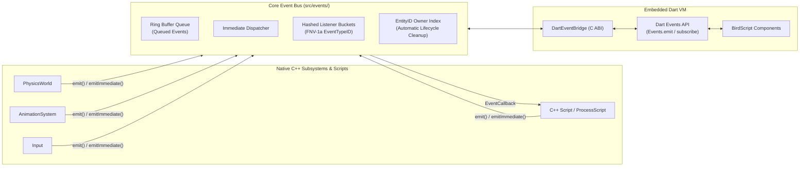
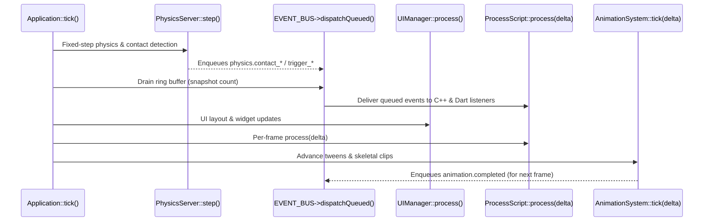

# Architecture: Event & Messaging System

Bird Engine includes an engine-wide, decoupled publish-subscribe **Event & Messaging System** (`bird::EventBus`, located in `src/events/`) that operates seamlessly across both native C++ subsystems and Dart scripts (`Events` in `package:bird_engine/bird_engine.dart`).

---

## 1. Architecture Overview



### Key Design Goals
- **Cross-Language Transparency**: Any event emitted in C++ can be received by both C++ and Dart listeners, and any event emitted in Dart (`Events.emit` / `Events.emitImmediate`) is delivered to both C++ and Dart listeners.
- **Zero-Allocation Hot Paths**: Event names are hashed to a 64-bit `EventTypeID` using `constexpr` FNV-1a (`bird::hashEventName("...")`). Native subsystems can check `EVENT_BUS->hasSubscribers(kEventId)` in $O(1)$ before constructing an `EventPayload`.
- **Re-Entrant Dispatch Safety**: Listeners can freely `subscribe()`, `unsubscribe()`, `emit()`, `emitImmediate()`, or destroy entities from inside an active event callback without invalidating iterators.
- **Automatic Entity Lifecycle Cleanup**: Subscriptions tied to a `WorldObject` (`EntityID`) are automatically unsubscribed when `WorldObject::deinit()` runs or when the entity is destroyed, preventing dangling pointers and stale callbacks on dead entities.

---

## 2. Queued vs. Immediate Events

The Event Bus supports two distinct delivery modes:

| Feature | Queued Events (`emit`) — **Default** | Immediate Events (`emitImmediate`) |
|---|---|---|
| **When Dispatched** | Deferred to the frame's event dispatch phase (`EVENT_BUS->dispatchQueued()`), right **after fixed-step physics** and **before UI and script `process(delta)`**. | Synchronously inside the caller's stack frame before `emitImmediate()` returns. |
| **Storage** | Fixed-capacity ring buffer (default `1024` slots, FIFO order). | None (dispatched in-place). |
| **Cascading Emissions** | Events emitted via `emit()` *during* `dispatchQueued()` are deferred to the **next frame**, preventing infinite feedback loops. | Nested `emitImmediate()` calls execute immediately (tracked by a re-entrant dispatch depth counter). |
| **Best Used For** | Gameplay notifications, physics contacts, animation completion, input notifications, cross-entity messaging. | Urgent state transitions where the emitter requires listeners to react before the next line of code runs. |

### Frame Loop Placement (`Application::tick`)



---

## 3. Event Identifiers & Payload Conventions

### Event Naming Convention
Use lowercase, dot-namespaced event names (`<domain>.<action>`):
- Built-in physics events:
  - `physics.contact_begin` — `{ "selfEntityId": int, "otherEntityId": int, "point": Vector3, "normal": Vector3 }`
  - `physics.contact_end` — `{ "selfEntityId": int, "otherEntityId": int }`
  - `physics.trigger_enter` — `{ "selfEntityId": int, "otherEntityId": int, "point": Vector3, "normal": Vector3 }`
  - `physics.trigger_exit` — `{ "selfEntityId": int, "otherEntityId": int }`
- Built-in input events:
  - `input.key_down` — `{ "key": int, "modifiers": int, "repeat": bool }`
  - `input.key_up` — `{ "key": int, "modifiers": int }`
  - `input.mouse_button_down` — `{ "button": int, "modifiers": int, "position": Vector2 }`
  - `input.mouse_button_up` — `{ "button": int, "modifiers": int, "position": Vector2 }`
- Built-in animation events:
  - `animation.completed` — `{ "handleIndex": int, "handleGeneration": int }`

In C++, you can precompute the 64-bit FNV-1a hash at compile time:
```cpp
constexpr bird::EventTypeID kPlayerDamaged = bird::hashEventName("player.damaged");
```

### `EventPayload` Types
`bird::EventPayload` is backed by a flat `std::vector<EventField>` rather than a node-based map, so empty payloads perform **zero heap allocations** and typical 1–6 field payloads stay in a single cache line.

Supported value types across both C++ and Dart:

| `EventValueType` | C++ Type | Dart Type |
|---|---|---|
| `Null` | `std::monostate` (`setNull`) | `null` |
| `Bool` | `bool` | `bool` |
| `Int` | `int64_t` (also accepts `int`, `uint64_t` / `EntityID`) | `int` |
| `Double` | `double` (also accepts `float`; widens `int64_t` on read) | `double` |
| `String` | `std::string` / `const char*` | `String` |
| `Vector2` | `bird::Vector2` | `Vector2` |
| `Vector3` | `bird::Vector3` | `Vector3` |
| `Vector4` | `bird::Vector4` | `Vector4` |

---

## 4. C++ Usage Examples

### Emitting Queued and Immediate Events
```cpp
#include "events/EventBus.h"

// 1. Queued emission (dispatched after physics, before process())
bird::EventPayload payload;
payload.set("targetId", enemy->getID())
       .set("damage", 35)
       .set("critical", true)
       .set("hitPoint", bird::Vector3(2.0f, 1.0f, -4.5f));
bird::EVENT_BUS->emit("combat.hit", std::move(payload));

// 2. Immediate synchronous emission
bird::EventPayload urgent;
urgent.set("phase", "boss_enraged");
bird::EVENT_BUS->emitImmediate("game.phase_changed", urgent);
```

### Subscribing with Automatic Entity Cleanup
Inside a C++ `Script<T>` or `ProcessScript<T>`, pass `object()->getID()` as the third parameter (`ownerEntityId`) so the subscription is automatically removed when the entity is deinitialized or destroyed:

```cpp
class HealthScript : public bird::ProcessScript<bird::WorldObject> {
   public:
    void init() override {
        // Tied to object()->getID(): auto-unsubscribed on deinit() or ~WorldObject()
        m_subId = event_bus()->subscribe(
            "combat.hit",
            [this](const bird::EventPayload& p) {
                if (p.getInt("targetId") == static_cast<int64_t>(object()->getID())) {
                    m_hp -= p.getInt("damage", 0);
                }
            },
            object()->getID());
    }

   private:
    int64_t m_hp = 100;
    bird::SubscriptionID m_subId = bird::kInvalidSubscriptionID;
};
```

To unsubscribe manually at any time (even from inside the callback itself):
```cpp
event_bus()->unsubscribe(m_subId);
```

---

## 5. Dart Usage Examples

In Dart, import `package:bird_engine/bird_engine.dart` to use the static `Events` class.

### Subscribing & Emitting in a `BirdScript`
When `Events.subscribe()` is called inside a `BirdScript`'s `init()`, `process()`, or `physicsProcess()` lifecycle methods, `BirdScript` runs the method inside a Dart `Zone` carrying `object.getID()`. Subscriptions are **automatically bound to that entity** and cleaned up when the entity's `deinit()` runs or when it is removed from the scene:

```dart
import 'package:bird_engine/bird_engine.dart';

class PlayerController extends BirdScript<WorldObject> {
  int health = 100;
  late int _oneShotSubId;

  @override
  void init() {
    // Automatically owned by `object.getID()` via the active BirdScript Zone!
    // When this WorldObject is removed from the Scene, this listener is
    // automatically unsubscribed on both the C++ and Dart sides.
    Events.subscribe('combat.hit', (payload) {
      if (payload['targetId'] == object.getID()) {
        final dmg = (payload['damage'] as int?) ?? 0;
        final pos = payload['hitPoint'] as Vector3?;
        health -= dmg;
      }
    });

    // Listen to native physics contact events emitted by C++ PhysicsWorld:
    Events.subscribe('physics.contact_begin', (payload) {
      final a = payload['selfEntityId'] as int;
      final b = payload['otherEntityId'] as int;
      final point = payload['point'] as Vector3;
      // React to collision...
    });

    // Self-unsubscribing one-shot listener:
    _oneShotSubId = Events.subscribe('level.started', (payload) {
      Events.unsubscribe(_oneShotSubId);
    });
  }

  void attack(int targetEntityId) {
    // Queued event (default):
    Events.emit('combat.hit', {
      'targetId': targetEntityId,
      'damage': 25,
      'critical': false,
      'hitPoint': object.getWorldPosition(),
    });

    // Or synchronous immediate dispatch:
    Events.emitImmediate('ui.flash_crosshair', {'duration': 0.15});
  }
}
```

### Explicit Owner or Global Subscriptions in Dart
If you subscribe from a helper outside a `BirdScript` lifecycle hook, or want a global subscription that outlives a specific entity:
```dart
// Explicitly bind to a specific WorldObject:
final sub1 = Events.subscribe(
  'enemy.alerted',
  (payload) => print('Alert: $payload'),
  owner: guardEntity,
);

// Force a global (unowned) subscription even inside a BirdScript:
final subGlobal = Events.subscribe(
  'app.config_reloaded',
  (payload) => print('Config updated'),
  ownerEntityId: 0,
);
```

---

## 6. Re-Entrancy & Lifecycle Cleanup Internals

1. **Mid-Dispatch Unsubscribe**:
   While `EventBus::dispatchSingle()` is iterating a listener bucket (`m_dispatchDepth > 0`), calling `unsubscribe(id)` or `unsubscribeByOwner(entityId)` marks the entry `pendingRemoval = true` and nulls its `callback` immediately. Any remaining iteration steps in the current dispatch skip that entry, and `flushPendingMutations()` compacts the vector once the outermost dispatch finishes.
2. **Mid-Dispatch Subscribe**:
   New listeners registered while `m_dispatchDepth > 0` are appended to `m_pendingAdds` and merged into `m_listeners` when the outermost dispatch completes, ensuring active bucket vectors never reallocate mid-loop.
3. **Entity Teardown (`WorldObject::deinit` & `~WorldObject`)**:
   - `WorldObject::deinit()` invokes `deinit()` and `_deinit()` on all attached components, then calls `EVENT_BUS->unsubscribeByOwner(m_id)`.
   - `WorldObject::~WorldObject()` also calls `EVENT_BUS->unsubscribeByOwner(m_id)` as a safeguard for objects destroyed without being initialized into a scene.
   - Whenever a subscription is removed in C++, `EventBus` invokes its `UnsubscribeHook`, which notifies `DartEventBridge` to remove the corresponding Dart closure from `Events._callbacks` so the closure and any captured objects can be garbage-collected.
