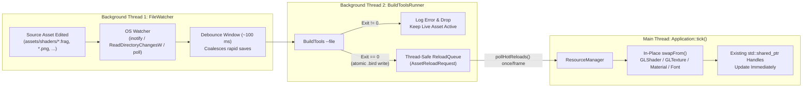

# Architecture: Asset Hot-Reloading & Dart Reload Readiness

Bird Engine's hot-reloading system lives in an isolated module (`src/hotreload/`) that lets developers edit shaders, textures, materials, fonts, and Dart scripts while the engine is running—without restarting the application or losing scene state.

---

## 1. Pipeline Overview

Hot-reloading is split into three decoupled stages so filesystem I/O and asset compilation never block the main rendering loop, and GPU/CPU resource handles are only mutated on the main thread:



---

## 2. Background File Watcher (`bird::hotreload::FileWatcher`)

`FileWatcher` monitors the raw source asset directory (`assets/` by default, plus an optional Dart scripts directory) recursively on a dedicated background thread:

- **Linux**: Uses kernel `inotify` (`IN_CLOSE_WRITE | IN_MODIFY | IN_MOVED_TO | IN_CREATE`) with recursive subdirectory registration (automatically watching newly created subdirectories) and a non-blocking self-pipe wakeup channel so `stop()` returns immediately.
- **Windows**: Uses overlapped `ReadDirectoryChangesW` with an explicit stop event handle.
- **macOS / fallback**: Uses a portable `std::filesystem::last_write_time` polling loop.

### Debouncing (~100 ms)
Editors frequently perform multi-step save sequences (truncate → write → flush → rename). `FileWatcher` records the timestamp of the latest event per normalized path and only dispatches a callback once the file has been quiet for `debounceInterval` (default `100 ms`).

### Ignored Files
The watcher automatically ignores baked `.bird` outputs, temporary atomic-write files (`.tmp`), editor swap/backup artifacts (`.swp`, `.swo`, `.bak`, `~`, `#...#`), and hidden dotfiles so recompiling an asset never triggers a feedback loop.

---

## 3. Asynchronous `BuildTools` Integration (`bird::hotreload::BuildToolsRunner`)

When `FileWatcher` emits a debounced change, `HotReloadManager` classifies the file by extension and routes it to `BuildToolsRunner`:

| Asset Kind | Extensions | Action |
|---|---|---|
| Shader stage | `.vert`, `.frag`, `.geom`, `.comp`, `.tesc`, `.tese` | `BuildTools --file <path> --force` |
| Shared GLSL header | `.glsl` | `BuildTools --dir <shadersDir>` (rebakes only shaders with stale include hashes) |
| Texture | `.png`, `.jpg`, `.jpeg`, `.tga`, `.bmp`, `.hdr`, etc. | `BuildTools --file <path> --force` |
| Material | `.mtl`, `.pbr`, `.mat` | `BuildTools --file <path> --force` |
| Font | `.ttf`, `.otf` | `BuildTools --file <path> --force` |
| 3D Model | `.obj`, `.fbx`, `.gltf`, `.glb` | `BuildTools --file <path> --force` |
| Dart Script | `.dart` | Skips `BuildTools`; pushes `DartScript` request directly to `ReloadQueue` |

### Subprocess Safety & Error Isolation
- `BuildToolsRunner::runProcess()` spawns `BuildTools` directly (`fork`/`execvp` on POSIX, `CreateProcessA` on Windows—never a shell) and drains `stdout` and `stderr` pipes concurrently via `poll()` / worker thread to prevent buffer deadlocks.
- `BuildTools` writes compiled outputs to `<output>.bird.tmp` and atomically renames them to `<output>.bird` so the runtime never reads a partially written binary.
- **Failure Isolation**: If `BuildTools` exits with a non-zero status (e.g., GLSL syntax error or corrupt image), `BuildToolsRunner` logs the exit code along with captured `stderr`/`stdout` via `bird::platform::log(LogLevel::Error, ...)` and **does not** push an `AssetReloadRequest`. The previous live asset remains active and the engine never crashes.

---

## 4. Main-Thread Handle Swapping (`ResourceManager::pollHotReloads()`)

Once `BuildTools` succeeds, `HotReloadManager` pushes an `AssetReloadRequest(AssetID)` onto the thread-safe, deduplicating `ReloadQueue`.

At the beginning of every frame in `Application::tick()`, the main thread calls `RESOURCE_MANAGER->pollHotReloads()`, which drains the queue and updates cached resources **in place**:

- **Shaders (`Shader::swapFrom` / `GLShader::swapFrom`)**: `ResourceManager` keeps the `ShaderBuilder` for every cached program. When a stage `.vert`/`.frag` reloads, every cached program referencing that stage is rebuilt and linked on the main GL thread. Only if linking succeeds does `GLShader::swapFrom()` swap `m_programId`, `m_pushConstantSize`, and `m_pushConstants`; the temporary object's destructor then calls `glDeleteProgram()` on the old program ID.
- **Textures (`Texture::swapFrom` / `GLTexture::swapFrom`)**: Reloads both linear (`<path>`) and sRGB (`<path>#srgb`) cache entries if present, uploads the new pixels via `TextureBuilder`, and swaps `m_textureID`, dimensions, format, and pixel buffer in place. The temporary destructor deletes the old GL texture ID.
- **Materials (`Material::swapFrom`)**: Copies updated PBR parameters and texture bindings in place and calls `markDirty()`, causing `acquireUniformBuffer()` to re-upload the std140 UBO on the next draw call.
- **Fonts (`Font::swapFrom`)**: Swaps glyph metrics, header, and the SDF atlas texture in place.

Because all scene components, materials, UI widgets, and scripts hold `std::shared_ptr<T>` references pointing to the same resource objects in `ResourceManager`, every reference across the scene updates immediately on the very next draw call.

---

## 5. Dart Hot-Reload Readiness Audit & `EntityID` Handles

### Audit of Raw Native Pointers in Current Dart FFI Bindings
When Dart's VM Service performs a hot-reload, Dart code is reloaded in place while existing Dart objects and native C++ scene entities continue living. Storing raw native `ffi.Pointer<ffi.Void>` addresses across hot-reloads creates two hazards:
1. **Dangling pointers**: If a C++ `WorldObject` or `Component` is destroyed while a Dart script retains a raw pointer in a field or closure, dereferencing it after a reload causes undefined behavior / segfaults.
2. **Stale `NativeCallable` closures**: In `src/dart/DartScriptComponent.h` and `dart/bird_engine/lib/src/bird_script.dart`:
   - `BirdDartInitFn`, `BirdDartProcessFn`, `BirdDartPhysicsProcessFn`, and `BirdDartDeinitFn` currently pass raw `void* hostWorldObject` pointers into Dart.
   - `DartAppScript::init()` passes `static_cast<void*>(object())` as an integer address to `appEntry(int sceneAddr)`.
   - `BirdScript<T>` caches `_host = WorldObject.fromHandle(ptr, owned: false)` as a raw-pointer-backed proxy.

### ID-Based Handle Solution (`EntityHandleRegistry` + `EntityHandle`)
Every `bird::WorldObject` already receives a unique, monotonically increasing `uint64_t m_id` (`WorldObject::getID()`). The hot-reload module builds on this with:

1. **`bird::hotreload::EntityHandleRegistry`** (`src/hotreload/EntityHandleRegistry.h`):
   - `WorldObject` automatically registers `(m_id, this)` in its constructor and unregisters `m_id` in `~WorldObject()`.
   - Exposes thread-safe `resolve(EntityID)` (returns `nullptr` if destroyed—never a dangling pointer) and `isValid(EntityID)`.
   - Exports C-ABI FFI symbols (`bird_EntityRegistry_getID`, `bird_EntityRegistry_resolve`, `bird_EntityRegistry_isValid`).
2. **Dart `EntityHandle`** (`dart/bird_engine/lib/src/bird_script.dart`):
   - Stores only `final int id` (`EntityID`).
   - Resolves on demand via `handle.resolve()` (returning `WorldObject?`, or `null` if destroyed) and `handle.isValid`.
3. **Dart Hot-Reload Lifecycle Hook**:
   - `ResourceManager::setDartReloadCallback(...)` receives main-thread notifications whenever a watched `.dart` file changes.
   - `DartRuntime::notifyHotReload()` invokes an optional top-level `onHotReload()` function in the active Dart isolate so scripts can refresh state after a VM Service reload (`DartRuntime::init(/*startServiceIsolate=*/true, 5858)`).

### Recommended Practice for Dart Scripts
- Store `EntityHandle` (or `int entityId`) in long-lived script fields rather than caching raw `WorldObject` proxy references.
- Resolve handles at the start of `process(delta)` / `physicsProcess(fixedDelta)` and guard against `null` when an entity may have been removed.
- Migrate future `DartScriptComponent` callbacks to pass `uint64_t hostEntityId` directly instead of `void* hostWorldObject`.

---

## 6. Build Flags & Release Stripping

Hot-reloading is strictly a development workflow feature and is **compiled out** in Release, MinSizeRel, and device builds (Android, Web, iOS):

| CMake Option | Default (Debug Host) | Default (Release / MinSizeRel / Device) | Effect |
|---|---|---|---|
| `BIRD_ENABLE_HOT_RELOAD` | `ON` | `OFF` | Compiles `FileWatcher`, `BuildToolsRunner`, `HotReloadManager`, and hooks in `ResourceManager`/`Application`. When `OFF`, `pollHotReloads()` is a zero-cost inline no-op and no background threads or subprocess code are linked. |

- Override explicitly at configure time if needed:
  ```bash
  cmake -B build -DCMAKE_BUILD_TYPE=Debug -DBIRD_ENABLE_HOT_RELOAD=OFF
  ```
- At runtime in development builds, set `BIRD_DISABLE_HOT_RELOAD=1` in the environment to disable automatic startup of the file watcher without recompiling.
- `EntityHandleRegistry` remains compiled in all builds (zero background threads) so ID-based Dart FFI handles behave identically in Debug and Release.
