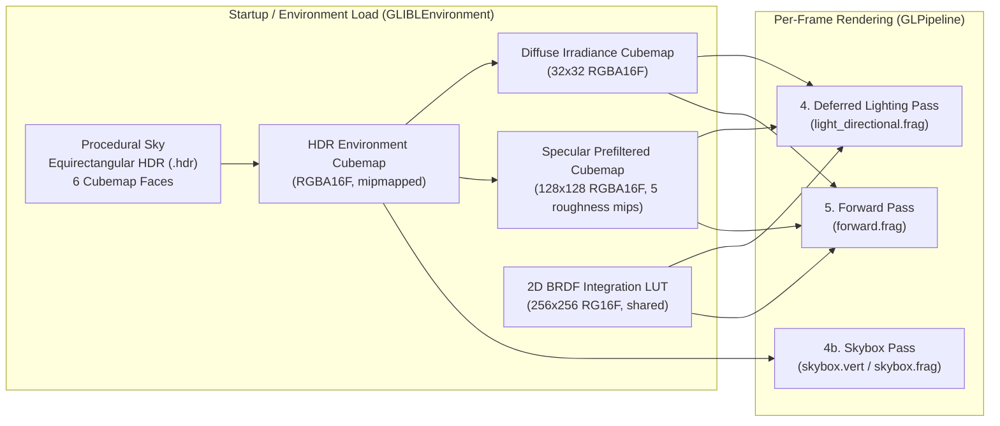

# Architecture: Image-Based Lighting (IBL) & Skybox

Bird Engine implements physically-based **Image-Based Lighting (IBL)** using Epic Games' split-sum approximation, integrated directly into both the **deferred PBR lighting pass** and the **forward PBR pass**, alongside an HDR **Skybox cubemap renderer**.

All IBL precomputation and rendering target **OpenGL 4.1+** and **OpenGL ES 3.0+ / WebGL 2**, requiring no compute shaders or storage buffers.

---

## 1. Pipeline Overview



---

## 2. Precomputed IBL Maps

An [`EnvironmentMap`](../../src/renders/generic/EnvironmentMap.h) resource owns three `RGBA16F` cubemaps and shares a process-wide `RG16F` 2D BRDF lookup table:

| Map | Sampler Binding | Default Resolution | Purpose |
|---|---|---|---|
| **Environment Cubemap** | `0` (in `skybox.frag`) | `512x512` (mipmapped) | Rendered at infinite distance by `GLSkyboxPass` and mip-sampled during GGX prefiltering to suppress fireflies. |
| **Diffuse Irradiance Cubemap** (`uIrradianceMap`) | `SAMPLER_BINDING_IBL_IRRADIANCE` (`10`) | `32x32` | Cosine-weighted hemisphere integral of incident environment radiance (`assets/shaders/ibl_irradiance.frag`). |
| **Specular Prefiltered Cubemap** (`uPrefilterMap`) | `SAMPLER_BINDING_IBL_PREFILTER` (`11`) | `128x128` (`5` mips: `0.0` .. `1.0` roughness) | GGX importance-sampled specular convolution using a Hammersley low-discrepancy sequence (`assets/shaders/ibl_prefilter.frag`). |
| **BRDF Integration LUT** (`uBrdfLut`) | `SAMPLER_BINDING_IBL_BRDF_LUT` (`12`) | `256x256` (`RG16F`) | Environment-independent split-sum Fresnel scale (`r`) and bias (`g`) indexed by $(N \cdot V, \text{roughness})$ (`assets/shaders/ibl_brdf_lut.frag`). |

---

## 3. Creating & Configuring an Environment Map

Attach an `EnvironmentMap` to the active camera's [`WorldEnvironment`](../../src/scene/Camera.h):

### Option A: Procedural HDR Sky (Zero External Assets)

```cpp
#include "renders/generic/EnvironmentMap.h"
#include "scene/Camera.h"

bird::SkyboxProceduralParams sky;
sky.sunDirection = bird::Vector3(0.4f, 0.7f, 0.5f);
sky.sunColor = bird::Vector3(1.0f, 0.95f, 0.85f);
sky.sunIntensity = 12.0f;
sky.zenithColor = bird::Vector3(0.12f, 0.30f, 0.68f);
sky.horizonColor = bird::Vector3(0.62f, 0.76f, 0.92f);
sky.groundColor = bird::Vector3(0.15f, 0.13f, 0.11f);

bird::WorldEnvironment& env = camera->getWorldEnvironment();
env.environmentMap = bird::EnvironmentMap::createProcedural(sky);
env.iblIntensity = 1.0f;
env.renderSkybox = true;
```

### Option B: Equirectangular HDR Image (`.hdr`)

```cpp
bird::IBLQualitySettings quality;
quality.environmentSize = 512;
quality.irradianceSize = 32;
quality.prefilterSize = 128;
quality.prefilterMipLevels = 5;

env.environmentMap = bird::EnvironmentMap::createFromEquirectangular(
    "assets/textures/studio_small.hdr", quality);
```

### Option C: Six Cubemap Face Images (`+X, -X, +Y, -Y, +Z, -Z`)

```cpp
env.environmentMap = bird::EnvironmentMap::createFromCubemapFaces({
    "assets/skybox/px.hdr", "assets/skybox/nx.hdr",
    "assets/skybox/py.hdr", "assets/skybox/ny.hdr",
    "assets/skybox/pz.hdr", "assets/skybox/nz.hdr"
});
```

---

## 4. Shader Integration (`evaluateIBL`)

In [`assets/shaders/include/pbr.glsl`](../../assets/shaders/include/pbr.glsl), roughness-aware Schlick Fresnel (`fresnelSchlickRoughness`) splits energy between dielectric diffuse irradiance and metallic/dielectric specular reflections:

$$\mathbf{F} = \mathbf{F}_0 + (\max(\mathbf{1} - \text{roughness}, \mathbf{F}_0) - \mathbf{F}_0)(1 - (N \cdot V))^5$$

$$\mathbf{L}_{\text{IBL}} = \Big((1 - \text{metallic})(\mathbf{1} - \mathbf{F}) \cdot \text{albedo} \cdot \mathbf{E}_{\text{irradiance}}(N) + \mathbf{L}_{\text{prefilter}}(R, \text{roughness} \cdot \text{MAX\_LOD}) \cdot (\mathbf{F} \cdot \text{brdf}_x + \text{brdf}_y)\Big) \cdot \text{AO} \cdot \text{iblIntensity}$$

When `WorldEnvironment::environmentMap` is `nullptr` (or `iblIntensity <= 0.0f`), `GlobalUBOData::cameraParams.w` is `0.0` and shaders automatically fall back to `evaluateAmbient` using `ambientColor * ambientIntensity`.

---

## 5. Skybox Rendering Pass (`GLSkyboxPass`)

[`GLSkyboxPass`](../../src/renders/opengl/passes/GLSkyboxPass.h) runs immediately after the deferred lighting pass and before the forward pass:

1. Strips translation from the camera view matrix (`mat4(mat3(view))`) in [`assets/shaders/skybox.vert`](../../assets/shaders/skybox.vert).
2. Outputs `gl_Position = clipPos.xyww` so normalized device coordinate depth equals `1.0` (the far plane).
3. Renders with `GLDepthFunc::LessEqual` and `depthWrite = false`, shading only unoccluded background pixels (`depth == 1.0`) in the HDR buffer so ACES tone mapping, exposure, and FXAA apply uniformly to both geometry and sky.
