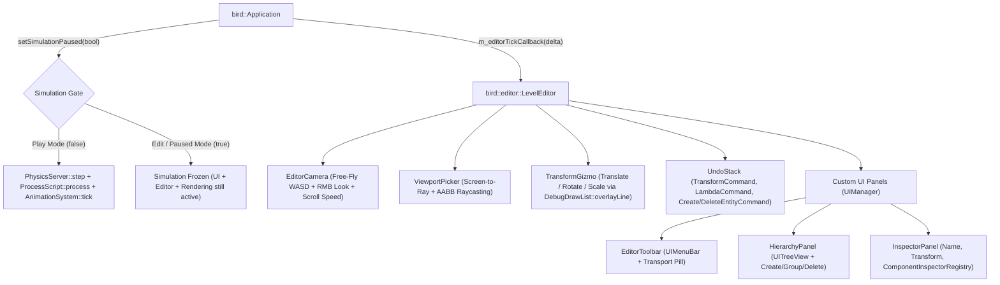

# Architecture: Level Editor

Bird Engine includes an integrated, native **Level Editor** subsystem in `src/editor/`, built entirely on top of the engine's retained 2D custom UI system (`src/scene/2D/`) and 3D `DebugDrawList` renderer—with zero third-party UI dependencies (no Dear ImGui).

---

## 1. Architectural Overview



### Core Source Files

| File | Responsibility |
|---|---|
| [LevelEditor.h](../../src/editor/LevelEditor.h) / [LevelEditor.cpp](../../src/editor/LevelEditor.cpp) | Top-level editor controller coordinating mode transitions (`Edit`, `Play`, `Paused`), pre-play transform snapshots, keyboard shortcuts, viewport picking, gizmo dragging, and serialization hooks. |
| [EditorCamera.h](../../src/editor/EditorCamera.h) / [EditorCamera.cpp](../../src/editor/EditorCamera.cpp) | Viewport free-fly camera controller (RMB mouse look, WASD + Q/E movement, Shift speed boost, scroll-wheel speed adjustment, and `F` focus framing). |
| [HierarchyPanel.h](../../src/editor/HierarchyPanel.h) / [HierarchyPanel.cpp](../../src/editor/HierarchyPanel.cpp) | Retained `UIPanel` on the left edge hosting a recursive `UITreeView` of the active `Scene` tree with `+ Entity`, `+ Group`, and `Delete` actions. |
| [InspectorPanel.h](../../src/editor/InspectorPanel.h) / [InspectorPanel.cpp](../../src/editor/InspectorPanel.cpp) | Retained `UIPanel` on the right edge hosting a `UIScrollView` with the selected entity's editable Name, 3D Transform (`UINumberField` rows), and collapsible `UIExpander` sections for every attached `Component`. |
| [ComponentInspector.h](../../src/editor/ComponentInspector.h) / [ComponentInspector.cpp](../../src/editor/ComponentInspector.cpp) | `InspectorBuilder` widget factory and `ComponentInspectorRegistry` mapping `std::type_index` of `Component` subclasses to live-editable, Undo/Redo-backed UI builders. |
| [EditorToolbar.h](../../src/editor/EditorToolbar.h) / [EditorToolbar.cpp](../../src/editor/EditorToolbar.cpp) | Top `UIMenuBar` (`File`, `Edit`, `Gizmo`, `Simulation`) and floating center transport bar (`Play`, `Pause`, `Stop`, `Move`, `Rot`, `Scale`, `World/Local`, `Undo`, `Redo`, `Save`, `Load`). |
| [ViewportPicker.h](../../src/editor/ViewportPicker.h) / [ViewportPicker.cpp](../../src/editor/ViewportPicker.cpp) | Screen-space cursor unprojection (`screenToRay`), slab-method ray-AABB intersection (`intersectRayAABB`), world AABB aggregation from `MeshComponent`s, and recursive scene raycast picking. |
| [TransformGizmo.h](../../src/editor/TransformGizmo.h) / [TransformGizmo.cpp](../../src/editor/TransformGizmo.cpp) | Screen-size-invariant 3D Translate, Rotate, and Scale gizmos rendered with always-on-top `DebugDrawList::overlayLine()` primitives and ray-segment / ray-plane drag solvers. |
| [UndoStack.h](../../src/editor/UndoStack.h) / [UndoStack.cpp](../../src/editor/UndoStack.cpp) | Bounded command history stack with `TransformCommand`, `LambdaCommand`, `CreateEntityCommand`, and `DeleteEntityCommand`. |

---

## 2. Bootstrapping the Level Editor

Attach `bird::editor::LevelEditor` inside your scene entry script (or game bootstrap) and wire its `update(delta)` method to `Application::setEditorTickCallback` so the editor continues running while gameplay simulation is paused:

```cpp
#include <Application.h>
#include <editor/LevelEditor.h>
#include <scene/Camera.h>
#include <scene/Scene.h>
#include <scene/components/Script.h>

class MyEditorScene : public bird::Script<bird::Scene> {
   public:
    void init() override {
        auto cam = bird::_own_mk<bird::Camera>(1280, 720);
        cam->setName("Main Camera");
        cam->setWorldPosition(bird::Vector3(0.0f, 3.0f, 8.0f));
        cam->enable();
        bird::Camera* camPtr = cam.get();
        scene()->addChild(std::move(cam));

        m_editor = std::make_unique<bird::editor::LevelEditor>(
            bird::APPLICATION->getUIManager(),
            scene(),
            camPtr,
            bird::APPLICATION);

        // Optional: plug into your Scene Serialization API
        bird::editor::SceneSerializationHooks hooks;
        hooks.defaultScenePath = "assets/scenes/level01.scene.bird";
        hooks.saveScene = [](bird::Scene* root, const std::string& path) {
            // Serialize `root` to `path`
            return true;
        };
        hooks.loadScene = [](bird::Scene* root, const std::string& path) {
            // Deserialize `path` into `root`
            return true;
        };
        m_editor->setSerializationHooks(std::move(hooks));

        // Tick the editor every frame (even when simulation is paused in Edit Mode)
        bird::APPLICATION->setEditorTickCallback([this](float delta) {
            if (m_editor) m_editor->update(delta);
        });
    }

    void deinit() override {
        bird::APPLICATION->setEditorTickCallback(nullptr);
        m_editor.reset();
    }

   private:
    std::unique_ptr<bird::editor::LevelEditor> m_editor;
};
```

---

## 3. Editor Modes & Simulation Lifecycle

`LevelEditor` manages three states via `EditorMode`:

1. **`EditorMode::Edit` (Default):**
   - `Application::setSimulationPaused(true)` freezes fixed-step physics (`PhysicsServer::step()`), script callbacks (`ProcessScript::process()` / `physicsProcess()`), and world animations (`AnimationSystem::tick()`).
   - `UIManager::process(delta)`, the editor tick callback, dirty matrix updates (`Application::processScene()`), and multi-pass rendering continue at full frame rate.
   - The **Hierarchy Panel**, **Inspector Panel**, **Toolbar**, reference ground grid, selection wireframe box, and 3D **Transform Gizmo** are visible and interactive.
2. **`EditorMode::Play`:**
   - Before unpausing, `LevelEditor` captures a recursive `TransformSnapshot` of every entity in the root `Scene` (plus the camera pose).
   - The Hierarchy and Inspector side panels hide automatically so the game view is unobstructed while the top transport bar remains accessible.
   - `Application::setSimulationPaused(false)` resumes physics, scripts, and animations.
3. **`EditorMode::Paused`:**
   - Freezes simulation mid-play while revealing the Hierarchy and Inspector panels and enabling the free-fly `EditorCamera` and 3D gizmos so developers can inspect or tweak live gameplay state.
   - Clicking **Stop** (`F7`) or toggling back to Edit Mode (`F1`) restores all pre-play entity transforms and teleports physics bodies back to their initial poses.

---

## 4. Controls & Keybindings

### Free-Fly Viewport Camera (`EditorCamera`)

| Input | Action |
|---|---|
| **Hold Right Mouse Button (RMB) + Mouse Move** | Yaw (around world `+Y`) and Pitch (around local `+X`, clamped to $\pm 89^\circ$). Captures and hides the cursor while held. |
| **RMB + `W` / `S`** | Fly forward / backward along the camera's view axis. |
| **RMB + `A` / `D`** | Strafe left / right. |
| **RMB + `E` or `Space`** | Ascend along world `+Y`. |
| **RMB + `Q` or `Left Ctrl`** | Descend along world `-Y`. |
| **RMB + `Left Shift`** | Hold for $2.5\times$ fly speed boost. |
| **Mouse Scroll Wheel** | Multiplicatively increase / decrease base fly speed ($0.5$ to $200$ units/s). |
| **`F`** | Focus / frame the camera onto the currently selected entity's bounding box. |

### Viewport Selection, Gizmos & Editor Shortcuts

| Shortcut | Action |
|---|---|
| **Left Mouse Click (Viewport)** | Raycast pick the closest entity under the cursor, or grab a hovered 3D gizmo handle. |
| **`W`** | Switch 3D Gizmo to **Translate** mode (axis arrows + `XY`, `XZ`, `YZ` plane squares). |
| **`E`** | Switch 3D Gizmo to **Rotate** mode (`X`, `Y`, `Z` rotation circles). |
| **`R`** | Switch 3D Gizmo to **Scale** mode (axis scale cubes + center uniform scale cube). |
| **`T`** | Toggle Gizmo coordinate frame between **World** space and **Local** space. |
| **`Delete`** | Delete the currently selected entity (reversible via Undo). |
| **`Ctrl + N`** | Create a new empty `WorldObject` entity under the selected scene/group. |
| **`Ctrl + Z`** | Undo the last transform, property edit, rename, creation, or deletion. |
| **`Ctrl + Y`** or **`Ctrl + Shift + Z`** | Redo the most recently undone command. |
| **`Ctrl + S`** | Trigger the `SceneSerializationHooks::saveScene` hook. |
| **`Ctrl + O`** | Trigger the `SceneSerializationHooks::loadScene` hook. |
| **`F1`** | Toggle directly between **Edit Mode** and **Play Mode**. |
| **`F5`** | Enter **Play Mode** (or resume from Pause). |
| **`F6`** | Toggle **Pause** during Play Mode. |
| **`F7`** | **Stop** Play Mode and restore pre-play scene transforms. |

> [!NOTE]
> While any text input (`UITextBox` or `UINumberField`) owns keyboard focus (`UIManager::wantsKeyboard() == true`), single-key viewport shortcuts (`W`, `E`, `R`, `T`, `F`, `Delete`) and `Ctrl+Z/Y` are routed to the focused text widget instead of the 3D viewport.

---

## 5. 3D Viewport Picking & Transform Gizmos

### Raycast Picking (`ViewportPicker`)
1. `ViewportPicker::screenToRay()` converts the 2D window cursor position $(x, y)$ to Normalized Device Coordinates in $[-1, 1]^2$ and unprojects the near and far clip planes through `(perspective * view)^-1`.
2. `ViewportPicker::computeEntityBounds()` computes each entity's world-space `AABB` by transforming the local `AABB` of every attached `MeshComponent` (`AABB::transformed(modelMatrix)`). Entities without meshes (such as lights, cameras, or empty group nodes) receive a fallback pick box of half-extent `kDefaultPickHalfExtent` ($0.35$ units).
3. `ViewportPicker::pick()` traverses the `Scene` hierarchy recursively and returns the `PickHit` with the smallest non-negative slab intersection distance.

### Interactive 3D Gizmos (`TransformGizmo`)
- **Always-On-Top Overlay Pass:** `DebugDrawList::overlayLine()` queues gizmo geometry into a dedicated overlay vertex buffer rendered by `GLDebugRenderer` with `GL_DEPTH_TEST` disabled, ensuring gizmo handles remain visible and grabbable even inside opaque meshes.
- **Constant Apparent Screen Size:** `TransformGizmo::computeScale()` scales the gizmo radius proportionally to `length(cameraPos - entityOrigin) * kScreenSizeFactor`.
- **Manipulation Modes:**
  - **Translate (`W`):** Single-axis constrained line projection (`closestParamOnAxis`) for `X`, `Y`, `Z` shafts, and ray-plane intersection (`intersectRayPlane`) for `XY`, `XZ`, `YZ` planar squares.
  - **Rotate (`E`):** Ray-plane intersection on the selected axis ring's plane, computing the signed angle between the initial and current radial vectors around the ring normal.
  - **Scale (`R`):** Local-axis distance delta for per-axis scale handles, or camera-plane horizontal drag for the center uniform scale cube.
- **Single-Step Undo Integration:** `beginDrag()` captures a `TransformSnapshot` before movement starts; `updateDrag()` mutates the entity live every frame; `endDrag()` emits a single `TransformCommand(target, before, after)` onto `UndoStack`.

---

## 6. Exposing Custom Components to the Inspector

The Inspector automatically displays built-in engine components (`LightComponent`, `MeshComponent`, `RigidBodyComponent`). To expose your own C++ `Component` subclass to the Inspector Panel with full Undo/Redo support, register an inspector callback with `ComponentInspectorRegistry::instance()`:

```cpp
#include <editor/ComponentInspector.h>
#include <scene/components/Component.h>

class OrbitComponent : public bird::Component {
   public:
    float radius = 5.0f;
    float angularSpeed = 1.5f;
    bool clockwise = true;
    bird::Vector3 pivotOffset{0.0f};
    bird::Vector3 tintColor{1.0f, 0.8f, 0.2f};

    void init() override {}
    void deinit() override {}
};

void registerGameInspectors() {
    bird::editor::ComponentInspectorRegistry::instance()
        .registerInspector<OrbitComponent>(
            "Orbit Controller",
            [](OrbitComponent* comp, bird::editor::InspectorBuilder& ui) {
                ui.addFloat(
                    "Radius",
                    [comp] { return comp->radius; },
                    [comp](float v) { comp->radius = v; },
                    0.1, 500.0, 0.25, 2);

                ui.addFloat(
                    "Angular Speed",
                    [comp] { return comp->angularSpeed; },
                    [comp](float v) { comp->angularSpeed = v; },
                    -50.0, 50.0, 0.1, 2);

                ui.addBool(
                    "Clockwise",
                    [comp] { return comp->clockwise; },
                    [comp](bool b) { comp->clockwise = b; });

                ui.addVec3(
                    "Pivot Offset",
                    [comp] { return comp->pivotOffset; },
                    [comp](const bird::Vector3& v) { comp->pivotOffset = v; });

                ui.addColorRGB(
                    "Tint Color",
                    [comp] { return comp->tintColor; },
                    [comp](const bird::Vector3& c) { comp->tintColor = c; });
            });
}
```

### Available `InspectorBuilder` Controls

| Method | Custom UI Widget Created | Notes |
|---|---|---|
| `addReadOnly(label, value)` | `UILabel` | Displays non-editable diagnostic metadata. |
| `addFloat(label, getter, setter, min, max, step, precision)` | `UINumberField` | Supports typing, arrow keys, mouse wheel, and vertical stepper scrubbing. |
| `addInt(label, getter, setter, min, max, step)` | `UINumberField` (precision 0) | Rounds to integer values and records a `LambdaCommand` on change. |
| `addBool(label, getter, setter)` | `UICheckBox` | Toggles boolean properties with Undo/Redo support. |
| `addString(label, getter, setter)` | `UITextBox` | Commits string edits on `Enter` with Undo/Redo support. |
| `addVec3(label, getter, setter, min, max, step, precision)` | Three horizontal `UINumberField`s | Edits `Vector3` `X`, `Y`, `Z` components independently. |
| `addColorRGB(label, getter, setter)` | `UIColorButton` | Opens a popup `UIColorPicker` editing linear RGB `Vector3`. |
| `addColorRGBA(label, getter, setter)` | `UIColorButton` | Opens a popup `UIColorPicker` editing RGBA `Vector4`. |
| `addDropdown(label, items, getter, setter)` | `UIDropdown` | Edits enum or index choices via a popup list. |
