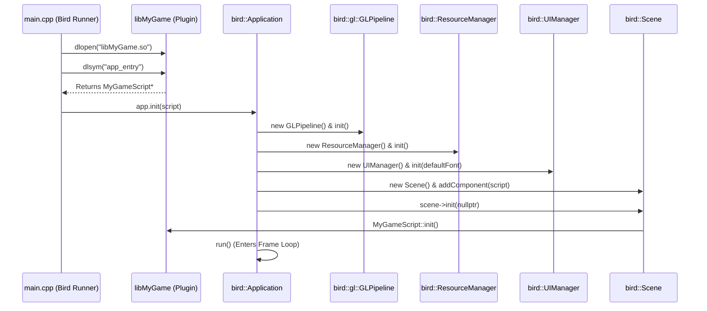
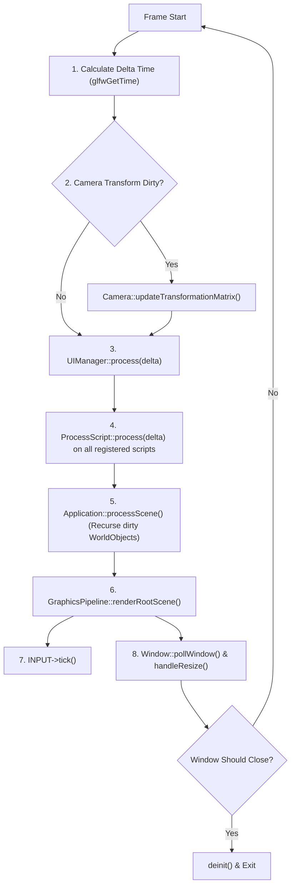

# Architecture: Lifecycle & Main Loop

This document describes the initialization sequence, frame loop mechanics, delta timing, and shutdown process in Bird Engine.

---

## 1. Bootstrapping Sequence

When running `./build/Bird libMyGame`, the boot sequence executes as follows:



---

## 2. The Per-Frame Loop (`Application::run`)

The core loop in [src/Application.cpp](file:///home/swdhahn/Programming/cWorkspace/bird-engine-gemrun/src/Application.cpp) executes continuously until the window is closed:



### Key Phases:
1. **Delta Time**:
   Calculated as `delta = Window::getGLFWTime() - lastTime`. Delta time is passed to UI timers and all `ProcessScript::process(delta)` callbacks to ensure framerate-independent physics and animations.
2. **Transform Dirty Checking (`processScene`)**:
   Instead of re-computing matrix transformations every time an object moves, `WorldObject` flags `m_needsMatrixUpdate = true`. During `processScene()`, only objects whose position, rotation, or scale changed will recalculate their 4x4 matrix:
   ```cpp
   for (auto& obj : scene->getChildren()) {
       if (obj->needsMatrixUpdate()) {
           obj->updateTransformationMatrix();
       }
   }
   ```
3. **Multi-Pass Rendering**:
   Delegated to `GraphicsPipeline::renderRootScene(m_scene)` which renders the 3D scene, post-processing filters, and 2D UI overlay.
4. **Platform Event Coalescing**:
   `window->pollWindow()` dispatches GLFW key and mouse events. If the window was resized, `pollResize()` coalesces rapid window manager events and triggers `handleResize()`.

---

## 3. Teardown (`Application::deinit`)

When `window->shouldWindowClose()` becomes true:
1. The active `Scene` hierarchy is deinitialized, invoking `deinit()` across all child entities and components.
2. Registered scripts are unregistered.
3. The `UIManager` and `GraphicsPipeline` tear down GPU resources, buffers, and shaders.
4. The application exits gracefully with exit code 0.
