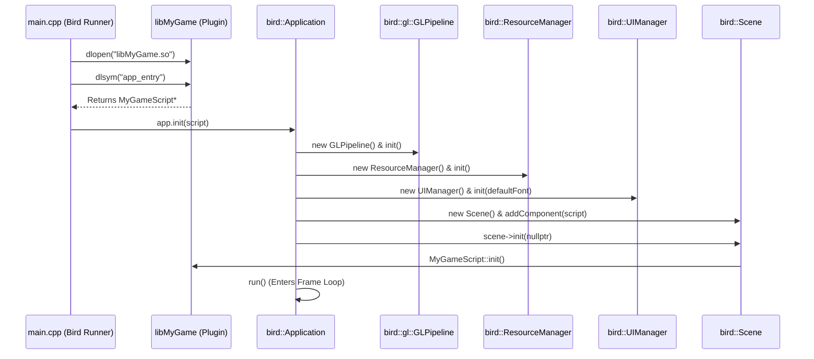
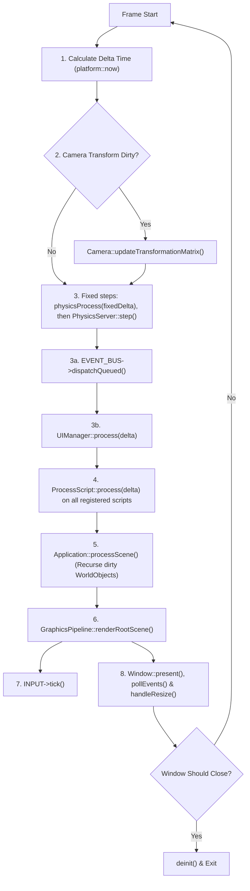

# Architecture: Lifecycle & Main Loop

This document describes the initialization sequence, frame loop mechanics, delta timing, and shutdown process in Bird Engine.

---

## 1. Bootstrapping Sequence

When running `./build/Bird libMyGame`, the boot sequence executes as follows:



---

## 2. The Per-Frame Loop (`Application::run` and `Application::tick`)

The core loop in [src/Application.cpp](file:///home/swdhahn/Programming/cWorkspace/bird-engine-gemrun/src/Application.cpp) calls `Application::tick()` once per frame until the window is closed. Platforms that own their event loop (Android, iOS, the Web) call `tick()` from their frame callback instead of `run()`:



### Key Phases:
1. **Delta Time**:
   Calculated as `delta = platform::now() - lastFrameTime` from a monotonic clock. Delta time is passed to UI timers and all `ProcessScript::process(delta)` callbacks to ensure framerate-independent physics and animations.
2. **Fixed-Step Physics**:
   A `FixedStepClock` (default 1/60 s) turns the frame delta into zero or more whole steps. Long frames are clamped to 0.25 s and at most 8 steps run per frame; older backlog is dropped, so a slow machine slows the simulation instead of spiralling. Each step first calls `ProcessScript::physicsProcess(fixedDelta)` on every registered script, then `PhysicsServer::step()`, which steps every scene's `PhysicsWorld` (see [Physics](physics.md)). Input is ticked once per frame, outside the physics loop.
3. **Transform Dirty Checking (`processScene`)**:
   Instead of re-computing matrix transformations every time an object moves, `WorldObject` flags `m_needsMatrixUpdate = true`. During `processScene()`, only objects whose position, rotation, or scale changed will recalculate their 4x4 matrix:
   ```cpp
   for (auto& obj : scene->getChildren()) {
       if (obj->needsMatrixUpdate()) {
           obj->updateTransformationMatrix();
       }
   }
   ```
4. **Multi-Pass Rendering**:
   Delegated to `GraphicsPipeline::renderRootScene(m_scene)` which renders the 3D scene, post-processing filters, and 2D UI overlay.
5. **Platform Event Coalescing**:
   `window->present()` shows the frame and `window->pollEvents()` delivers key, character, button, cursor and scroll events to `Input`, which tracks key and button state for actions and forwards the events to the UI. If the window was resized, `pollResize()` coalesces rapid window manager events and triggers `handleResize()`.

### Platform Layer

Everything that touches the operating system sits behind small interfaces in `src/platform/`, selected at build time by the CMake option `BIRD_PLATFORM`:

| Interface | Purpose | `DESKTOP` | `HEADLESS` |
|---|---|---|---|
| `Window` (`renders/Window.h`) | Surface, context, events, clipboard, cursors | `GlfwWindow` | `HeadlessWindow` (EGL pbuffer, no input) |
| `platform::VFS` | Reads packaged assets | `NativeVFS` (file system) | `NativeVFS` |
| `platform::now()` | Monotonic frame clock | `steady_clock` | `steady_clock` |
| `platform::log()` | Log lines with a replaceable sink | Console | Console |

Only `src/platform/desktop/` includes GLFW. Key and button codes are the engine's `KEY_*` and `MOUSE_BUTTON_*` values (GLFW's numbering), so other backends translate their native codes into the same space.

`HEADLESS` renders off-screen through EGL (Mesa's surfaceless platform where available), stops after `BIRD_HEADLESS_FRAMES` frames (default 120), and pairs with `BIRD_CAPTURE` for automated frame captures on machines without a display:

```bash
cmake -B build-headless -DBIRD_PLATFORM=HEADLESS -DBIRD_GL_PROFILE=ES
cmake --build build-headless --target Bird
BIRD_CAPTURE=frame.ppm BIRD_CAPTURE_FRAME=60 ./build-headless/Bird test/build/libBird_test
```

---

## 3. Teardown (`Application::deinit`)

When `window->shouldWindowClose()` becomes true:
1. The active `Scene` hierarchy is deinitialized recursively: every component receives `deinit()` followed by `_deinit()`, which unregisters scripts and destroys physics bodies.
2. The root `Scene` is destroyed, taking its `PhysicsWorld`s with it, and then the `PhysicsServer` (worker threads and Jolt's global registry). A server destroyed while a world is alive aborts, since the world would dangle.
3. The `UIManager` and `GraphicsPipeline` tear down GPU resources, buffers, and shaders.
4. The application exits gracefully with exit code 0.
