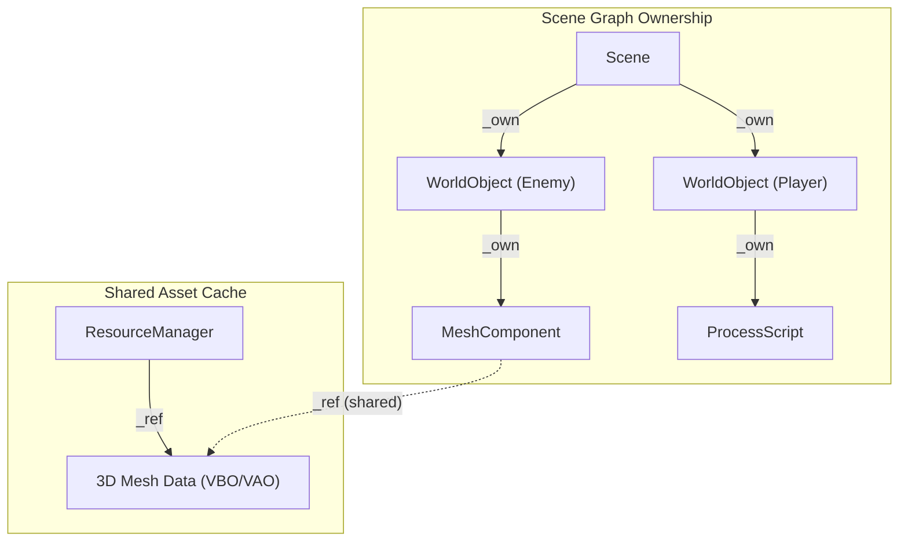

# Architecture: Memory & Ownership Model

Bird Engine adheres to explicit, modern C++ ownership semantics to guarantee safety, zero memory leaks, and clear object lifecycles.

---

## 1. Smart Pointer Aliases (`Memory.hpp`)

In [src/util/Memory.hpp](file:///home/swdhahn/Programming/cWorkspace/bird-engine-gemrun/src/util/Memory.hpp), the engine defines clean, idiomatic aliases for standard smart pointers:

| Alias | C++ Standard Type | Meaning & Use Case |
|---|---|---|
| `bird::_own<T>` | `std::unique_ptr<T>` | **Exclusive Ownership**. One entity or container owns this resource. Moved via `std::move` or `_mv()`. |
| `bird::_ref<T>` | `std::shared_ptr<T>` | **Shared Ownership**. Multiple systems hold a reference (e.g. `Mesh`, `Texture`, `Shader`, `Material`). |
| `bird::_weak<T>` | `std::weak_ptr<T>` | **Non-Owning Reference**. Observes a shared resource without extending its lifetime. |
| `bird::_own_mk<T>(...)` | `std::make_unique<T>(...)` | Factory constructing an exclusively owned object. |
| `bird::_ref_mk<T>(...)` | `std::make_shared<T>(...)` | Factory constructing a shared reference object. |
| `bird::_mv(...)` | `std::move(...)` | Move helper. |

---

## 2. Scene Graph Ownership Hierarchy

The scene graph strictly follows unique ownership semantics:

```
Scene (Root)
  └── owns std::vector<_own<WorldObject>> m_children;
        └── owns std::vector<_own<Component>> m_components;
```



### Adding and Moving Nodes
When you add a child entity or attach a component, ownership is transferred:
```cpp
auto obj = bird::_own_mk<bird::WorldObject>();
obj->addComponent(bird::_own_mk<bird::MeshComponent>(mesh));

// Transferred to scene via std::move
scene->addChild(std::move(obj));
```

### Raw Observer Pointers
To query or manipulate nodes without taking ownership, Bird Engine uses **raw non-owning observer pointers**:
- `WorldObject* Component::world_object()`
- `Scene* WorldObject::getParent()`
- `Camera* GraphicsPipeline::getCamera()`

These raw pointers are valid for the duration of the entity's lifetime in the scene. When an entity is removed via `removeChild()`, its destructor runs automatically, tearing down its components.

---

## 3. UI Node Ownership

The 2D UI tree (`UIObject`) uses `std::unique_ptr<UIObject>` for children:
```cpp
class UIObject {
protected:
    std::vector<std::unique_ptr<UIObject>> m_children;
    UIObject* m_parent = nullptr;
};
```
When you call `parent->add<T>(args...)`, the parent instantiates the widget, moves it into `m_children`, sets `m_parent = this`, and returns a raw pointer (`T*`) for immediate method chaining.

---

## 4. Asset Caching & Reference Counting

Assets such as textures, shaders, fonts, and meshes are loaded via `bird::ResourceManager` and stored as `std::shared_ptr<T>` (`_ref<T>`).
- If multiple `WorldObject` entities share the same 3D model or material, they all point to the same shared GPU buffer and texture resources.
- If all entities using an asset are destroyed and the cache is cleared, the GPU resources are freed automatically.
