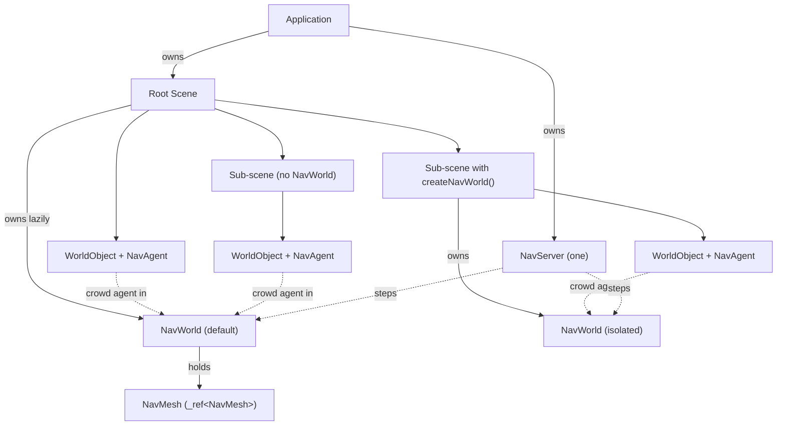

# Navigation & AI Pathfinding

Bird Engine provides 3D navigation mesh generation, point-to-point pathfinding, and local crowd steering powered by [Recast & Detour](https://github.com/recastnavigation/recastnavigation) (v1.6.0). Like the physics subsystem, navigation lives in its own isolated module (`src/navigation/`). Recast and Detour headers are confined to `NavInternal.h`, keeping all public engine and plugin headers free of third-party navigation includes.

---

## 1. The Pieces

| Type | Header | Role |
|------|--------|------|
| `NavServer` | `navigation/NavServer.h` | Process-wide navigation state and registry of active `NavWorld`s. Owned by `Application` (or created standalone in headless tests). |
| `NavWorld` | `navigation/NavWorld.h` | Per-scene navigation space pairing a `NavMesh` with a Detour `dtCrowd` instance. Owned by a `Scene`. |
| `NavMesh` | `navigation/NavMesh.h` | Walkable polygon mesh built from static scene/mesh geometry via Recast, or loaded from a serialized `.bnav` binary file. |
| `NavAgent` | `navigation/NavAgent.h` | Component that steers a `WorldObject` smoothly along a computed path with configurable speed, acceleration, stopping distance, and RVO local avoidance. |
| `NavPath` | `navigation/NavTypes.h` | Funnel-smoothed 3D waypoint polyline returned by `findPath()`. |
| `NavPoint` | `navigation/NavTypes.h` | World-space point and polygon reference returned by `findNearestPoint()`. |
| `NavMeshBuildSettings` | `navigation/NavTypes.h` | Recast voxelization, agent clearance, region, and polygonization parameters. |
| `NavAgentSettings` | `navigation/NavTypes.h` | Agent radius, height, max speed, acceleration, stopping distance, and rotation parameters. |
| `NavDebugSettings` | `navigation/NavTypes.h` | Controls 3D debug wireframe drawing for NavMesh polygons, boundaries, agent bounds, and active paths. |
| `NavInternal.h` | (engine only) | Private PIMPL header wrapping `Recast.h`, `DetourNavMesh.h`, `DetourNavMeshQuery.h`, and `DetourCrowd.h`. |

---

## 2. Scene Ownership & Lifecycle

Navigation worlds follow the exact same scene-tree inheritance rules as `PhysicsWorld`:

- Calling `scene->getNavWorld()` walks up the scene hierarchy to find the nearest ancestor `Scene` that owns a `NavWorld`. If none does, the root `Scene` lazily creates a default `NavWorld`.
- Calling `scene->createNavWorld(settings)` gives a sub-scene its own isolated `NavWorld` and Detour Crowd instance.
- `Scene` declares `m_navWorld` before `m_children` so child entities and their `NavAgent` components are destroyed while `m_navWorld` is still alive.
- `Application::tick()` steps `NavServer::step(delta)` immediately after `ProcessScript::process(delta)` and before scene matrix updates, so script-issued `setDestination()` calls take effect on the same frame.

---

## 3. Recast NavMesh Generation (`NavMeshBuildSettings`)

Recast voxelizes input triangle soup into a solid heightfield, filters out non-walkable ledges and low-clearance ceilings, erodes walkable areas by the agent radius, partitions regions via watershed distance fields, traces contours, and triangulates convex polygons (up to 6 vertices per polygon) paired with a height detail mesh.

### Build Parameters

| Field | Default | Unit | Description |
|-------|---------|------|-------------|
| `cellSize` | `0.3f` | metres | Horizontal (XZ) voxel resolution. Smaller values capture finer geometry at higher memory/CPU bake cost. Typically `agentRadius / 2` to `agentRadius / 3`. |
| `cellHeight` | `0.2f` | metres | Vertical (Y) voxel resolution. Should be at most `agentMaxClimb / 2`. |
| `agentRadius` | `0.6f` | metres | Agent cylinder radius used to erode walkable areas away from walls and obstacles. |
| `agentHeight` | `2.0f` | metres | Minimum vertical clearance required for an agent to stand under overhangs or doorways. |
| `agentMaxClimb` | `0.5f` | metres | Maximum vertical step height (stairs, curbs) an agent can step up without a ramp. |
| `agentMaxSlope` | `45.0f` | degrees | Maximum walkable surface incline in `(0, 90)`. Triangles steeper than this are marked unwalkable. |
| `regionMinSize` | `8.0f` | voxels | Minimum span count (squared) for isolated island regions; smaller islands are culled. |
| `regionMergeSize` | `20.0f` | voxels | Regions smaller than this span threshold are merged into adjacent larger regions. |
| `edgeMaxLen` | `12.0f` | metres | Maximum polygon contour edge length before subdivision. |
| `edgeMaxError` | `1.3f` | voxels | Maximum horizontal deviation allowed when simplifying raw voxel contours. |
| `vertsPerPoly` | `6` | count | Maximum vertices per convex NavMesh polygon (`3..6`). |
| `detailSampleDist` | `6.0f` | voxels | Detail height-mesh sample spacing (`0` disables detail sampling). |
| `detailSampleMaxError` | `1.0f` | voxels | Maximum vertical deviation allowed for detail mesh simplification. |

### Baking Entry Points

1. **From a Scene hierarchy (`NavMesh::buildFromScene`)**:
   Recursively collects every `WorldObject` in the scene tree that has a `MeshComponent`, transforms its vertices by the entity's world matrix, and skips entities that carry a `NavAgent` component (so dynamic agents are never baked into static floor geometry).
2. **From Mesh resources (`NavMesh::buildFromMeshes`)**:
   Merges CPU-side vertex and index buffers from a vector of `_ref<Mesh>`.
3. **From raw triangle soup (`NavMesh::build`)**:
   Bakes directly from `std::vector<Vector3>` vertices and `std::vector<uint32_t>` triangle indices.

---

## 4. Binary Serialization (`.bnav`)

Baking a large level can take tens to hundreds of milliseconds. To avoid rebaking every time a level loads at runtime, `NavMesh` supports saving and loading its compiled Detour tiles and build settings:

- **Format**:
  - `uint32_t magic` (`0x56414E42`, `"BNAV"`)
  - `uint32_t version` (`1`)
  - `NavMeshBuildSettings` fields
  - `dtNavMeshParams` header
  - `int32_t tileCount`, followed by `(uint32_t tileRef, int32_t dataSize, uint8_t[dataSize])` for each tile.
- **Saving**: `navMesh->saveToFile("assets/nav/level01.bnav")` or `navMesh->serialize()`.
- **Loading**: `NavMesh::loadFromFile("assets/nav/level01.bnav")` reads through `platform::VFS::get()` (supporting desktop filesystems, Android APK assets, and Web preloaded files) and reconstructs the `dtNavMesh` and `dtNavMeshQuery` in microseconds.

---

## 5. Detour Pathfinding & Crowd Simulation

### Direct Queries
Both `NavMesh` and `NavWorld` expose stateless Detour queries:
- **`findNearestPoint(position, searchExtents)`**: Projects an arbitrary 3D coordinate onto the closest walkable polygon within `searchExtents` (default `(2, 4, 2)` m), returning `std::optional<NavPoint>`.
- **`findPath(start, end, searchExtents)`**: Runs A* across the Detour polygon graph (`dtNavMeshQuery::findPath`) and applies the string-pulling funnel algorithm (`dtNavMeshQuery::findStraightPath`) to return a `NavPath` containing the ordered 3D corner waypoints. If the goal is in a disconnected island, `NavPath::isPartial()` is `true` and the path ends at the closest reachable point.

### `NavAgent` & Detour Crowd
Each `NavWorld` manages a `dtCrowd` instance configured with velocity-obstacle (RVO) local avoidance, turn anticipation, visibility optimization, and separation steering.

Each frame during `NavWorld::step(deltaTime)`:
1. **Pre-sync**: Compares each `NavAgent`'s host `WorldObject::getTransformRevision()` against the last synced revision. If user code moved or teleported the entity manually, the crowd agent is re-anchored at the new position and its active target is re-requested.
2. **Crowd Update**: `dtCrowd::update(deltaTime)` computes desired velocities, samples adaptive velocity obstacles against neighboring agents and walls, integrates acceleration and speed, and constrains positions to the NavMesh corridor.
3. **Arrival & Post-sync**: When an agent enters `stoppingDistance` (horizontally) and `height` (vertically) of its destination, its move target and velocity are cleared and `hasReachedDestination()` becomes `true`. Updated positions and optional smooth yaw rotations (`glm::slerp` toward movement heading) are written back to the `WorldObject`.

---

## 6. 3D Debug Visualization

Calling `APPLICATION->setNavDebugDraw(true)` (or `navWorld->debugDraw(debugDrawList, settings)`) renders navigation overlays through `GraphicsPipeline::getDebugDraw()`:

- **Cached Static Layer**: NavMesh interior polygon edges (`navMeshColor`, cyan) and outer boundary edges (`navMeshBoundaryColor`, deep blue) are written into `DebugDrawList::cachedLayer(navMesh)`. The vertex buffer is uploaded to the GPU once and reused across frames until the `NavMesh` version or `NavDebugSettings` colours/offset change.
- **Transient Agent Overlays**: Active agent cylinder wireframes (`agentBoundsColor`, green), velocity vectors, remaining funnel path segments (`agentPathColor`, yellow), and destination cross markers are emitted each frame when `drawAgentBounds` / `drawAgentPaths` are enabled.
