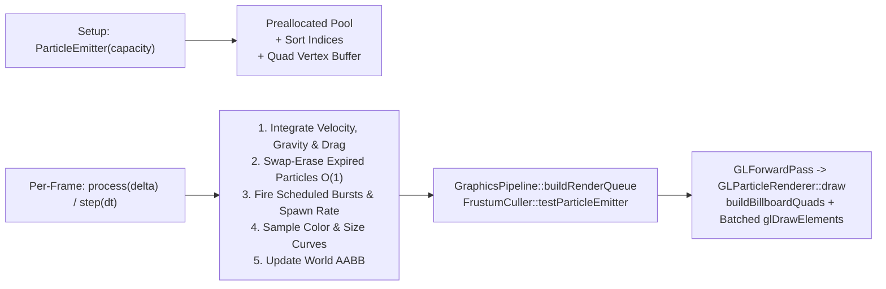

# Architecture: CPU Billboard Particle & VFX System

Bird Engine provides a zero-allocation CPU billboard particle system through [`ParticleEmitter`](../../src/scene/components/ParticleEmitter.h) and [`GLParticleRenderer`](../../src/renders/opengl/GLParticleRenderer.h). Particles simulate on the CPU in a fixed-capacity pool and render as batched camera-facing quads inside the **forward transparency pass**.

---

## 1. Memory & Simulation Architecture (Zero Per-Frame Allocations)



- **Fixed-Capacity Pool:** Constructing `ParticleEmitter(maxParticles)` (or calling `setCapacity(maxParticles)` during setup) preallocates `m_pool`, `m_sortIndices`, and `m_quadVertices` (`4 * maxParticles` vertices).
- **Zero Per-Frame Heap Allocations:** During `process(delta)`, `step(dt)`, `emitBurst(count)`, and `buildBillboardQuads(...)`, no heap allocations occur.
- **$O(1)$ Particle Recycling:** Active particles occupy contiguous indices `[0, getActiveCount())`. When a particle's `age >= lifetime`, it is overwritten by `m_pool[--m_activeCount]`.

---

## 2. Configuring a `ParticleEmitter` Component

Attach a `ParticleEmitter` to any `WorldObject` in your scene:

```cpp
#include "animation/Curve.h"
#include "scene/WorldObject.h"
#include "scene/components/ParticleEmitter.h"

auto* campfire = scene->addChild<bird::WorldObject>();
campfire->setPosition(bird::Vector3(0.0f, 0.5f, -4.0f));

auto emitter = std::make_unique<bird::ParticleEmitter>(512);

// 1. Spawn rate, cycle duration & scheduled bursts
emitter->setSpawnRate(45.0f); // 45 particles/sec
emitter->setDuration(3.0f);
emitter->setLooping(true);
emitter->addBurst(bird::ParticleBurst{0.0f, 20, 35}); // 20..35 burst at t = 0s

// 2. Lifetime, launch speed, cone spread, gravity & drag
emitter->setLifetimeRange(0.8f, 1.6f);
emitter->setInitialSpeedRange(1.5f, 3.5f);
emitter->setEmissionCone(bird::Vector3(0.0f, 1.0f, 0.0f), 0.35f); // 20 deg half-angle
emitter->setGravity(bird::Vector3(0.0f, 1.2f, 0.0f));             // buoyant updraft
emitter->setDrag(0.8f);

// 3. Multi-key Color-Over-Life curve (normalized age t in [0, 1])
bird::Curve<bird::Vector4> fireColor;
fireColor.addKey(0.0f, bird::Vector4(1.0f, 0.95f, 0.5f, 0.0f)); // fade in
fireColor.addKey(0.15f, bird::Vector4(1.0f, 0.65f, 0.15f, 1.0f));
fireColor.addKey(0.65f, bird::Vector4(0.85f, 0.18f, 0.05f, 0.7f));
fireColor.addKey(1.0f, bird::Vector4(0.15f, 0.15f, 0.15f, 0.0f)); // fade out
emitter->setColorOverLife(fireColor);

// 4. Size-Over-Life curve (world units)
bird::Curve<float> fireSize;
fireSize.addKey(0.0f, 0.15f);
fireSize.addKey(0.4f, 0.45f);
fireSize.addKey(1.0f, 0.10f);
emitter->setSizeOverLife(fireSize);

// 5. Blending & optional sprite texture
emitter->setBlendMode(bird::ParticleBlendMode::Additive);
// Optional: emitter->setTexture(bird::RESOURCE_MANAGER->loadColorTexture("assets/textures/spark.png"));

campfire->addComponent(std::move(emitter));
```

---

## 3. Forward Transparency Pass Rendering

Inside [`GLForwardPass::execute`](../../src/renders/opengl/passes/GLForwardPass.cpp), after forward opaque and transparent meshes are drawn:

1. **Camera-Facing Billboard Expansion:** `ParticleEmitter::buildBillboardQuads` extracts the camera's world-space `right`, `up`, and `forward` basis vectors from the view matrix and expands each active particle into 4 interleaved `ParticleQuadVertex` vertices (`position`, `uv`, `color`).
2. **Back-to-Front Sorting:** For `ParticleBlendMode::Alpha`, active particle indices are sorted back-to-front along `cameraForward` inside the preallocated `m_sortIndices` buffer before vertex generation.
3. **Depth & Blend State:** `GLParticleRenderer` configures:
   - `depthTest = true`, `depthFunc = GLDepthFunc::LessEqual` (particles are properly occluded by opaque G-buffer and forward geometry)
   - `depthWrite = false` (particles do not occlude each other)
   - `GLBlend::Alpha` ($\text{src} \cdot \alpha + \text{dst} \cdot (1 - \alpha)$) or `GLBlend::AdditiveAlpha` ($\text{src} \cdot \alpha + \text{dst}$)
4. **Procedural Soft Circle Fallback:** When no sprite texture is assigned (`getTexture() == nullptr`), [`assets/shaders/particle.frag`](../../assets/shaders/particle.frag) evaluates a smooth radial falloff (`smoothstep`) so emitters render clean soft circles without requiring external texture assets.
