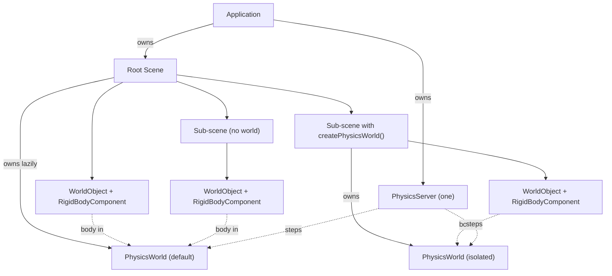

# Physics

Bird Engine simulates rigid bodies with [Jolt Physics](https://github.com/jrouwe/JoltPhysics) (v5.4). The integration is deliberately thin. Game code works with scenes, `WorldObject`s and components. Jolt types never appear in public headers, so a game plugin does not need Jolt's include paths or compile definitions.

---

## 1. The Pieces

| Type | Header | Role |
|------|--------|------|
| `PhysicsServer` | `physics/PhysicsServer.h` | Process-wide state: Jolt's allocator and type registry, the step scratch arena, worker threads and collision filters. Exactly one exists at a time; the `Application` owns it. |
| `PhysicsWorld` | `physics/PhysicsWorld.h` | One independent simulation (a `JPH::PhysicsSystem`). Owned by a `Scene`. Steps, gravity and queries. |
| `RigidBodyComponent` | `physics/RigidBodyComponent.h` | Gives its `WorldObject` a body in its scene's world. Forces, velocities and contact callbacks. |
| `CollisionShape` | `physics/CollisionShape.h` | Immutable, cheaply copied geometry: box, sphere, capsule, cylinder, convex hull, triangle mesh, compound. |
| `ContactEvent` | `physics/ContactEvent.h` | Payload of contact and trigger notifications. |
| `FixedStepClock` | `physics/FixedStepClock.h` | Turns frame time into whole fixed steps. |
| `PhysicsInternal.h` | (engine only) | The only header that includes Jolt: conversions, layer filters, the internal state of the server and worlds. |



---

## 2. Worlds Belong to Scenes

A body lives in the world of the **nearest scene that owns one**, walking up from the body's scene:

- The root scene creates a default world the first time something asks for it. Ordinary games never think about worlds.
- A sub-scene without its own world shares its parent's simulation. Its `m_physicsWorld` stays `nullptr`, and `getPhysicsWorld()` returns the ancestor's.
- `Scene::createPhysicsWorld(settings)` gives a sub-scene an **isolated** simulation, for example an editor preview or an inventory viewer. Bodies in different worlds never interact.
- Every world registers with the `PhysicsServer`, which steps them all in creation order.

The component resolves its world once, in `_init()`, an O(depth) walk, and keeps the pointer. Moving an object to another scene (`detachChild` then `addChild`) deinitializes and reinitializes it, so its body is rebuilt in the destination world.

Bodies always use **world-space** transforms, whatever the scene depth.

### Ownership and teardown
- `Scene` declares `m_physicsWorld` before `m_children`, so children (and their bodies) are destroyed while the world still exists.
- A `RigidBodyComponent` destroys its body in `_deinit()` and, as a safety net, in its destructor.
- `Application::deinit()` deinitializes and destroys the root scene before the server. The server aborts with a message if any world is still alive.

---

## 3. One Physics Step

`PhysicsWorld::step(fixedDelta)` runs four phases:

1. **Pre-sync.** For every body, the object's *transform revision* is compared with the revision last synchronized (an integer compare, O(bodies)). When the game moved the object:
   - static and dynamic bodies are teleported (`SetPositionAndRotation`);
   - kinematic bodies get `MoveKinematic`, so they push dynamic bodies along their path instead of popping through them. Their velocity is cleared on the next unchanged step, so they stop at the target;
   - a changed scale rebuilds the body's `ScaledShape`.
2. **Simulation.** `PhysicsSystem::Update` runs on the server's worker threads.
3. **Post-sync.** Only **active** bodies are visited (`GetActiveBodies`, O(awake bodies)). Dynamic ones write their pose back to their object. The component records the resulting revision, so the write-back is not mistaken for a game edit and echoed back. Sleeping piles cost nothing.
4. **Events.** Contact and trigger notifications are delivered on the calling (main) thread.

Every public method must be called from the main thread, outside `step()`.

### The fixed timestep
`Application::run()` owns a `FixedStepClock` (default 1/60 s, at most 8 steps per frame, frame time clamped to 0.25 s). Each step calls `ProcessScript::physicsProcess(fixedDelta)` on every script and then `PhysicsServer::step()`. Put forces and other simulation-coupled logic in `physicsProcess`; keep input-driven and visual logic in `process`.

---

## 4. Contacts and Triggers

Jolt reports contacts from worker threads, one callback per touching sub-shape pair. The engine:

1. **Records** them in a mutex-guarded queue (`ContactQueue`), copying only IDs, the point and the normal.
2. **Drains** the queue on the main thread after the step and reference-counts sub-shape pairs per body pair. As a result:
   - **begin** fires once when two bodies start touching, however many sub-shapes touch;
   - **end** fires once when the last pair separates, or when either body is destroyed;
   - a pair involving a **sensor** body produces **trigger** events (`onTriggerEnter` / `onTriggerExit`) instead.
3. **Keeps contacts across sleep.** Jolt drops the contacts of a body that falls asleep. The engine keeps such pairs *dormant*:
   - waking up still touching is not a new contact;
   - a body that wakes and fails to re-detect the pair (for example, after being teleported away) gets its end event.

Events reach the component's own callbacks (`setOnContactBegin` and the others) and every `ScriptComponent` on the same object (`onContactBegin`, `onContactEnd`, `onTriggerEnter`, `onTriggerExit`).

**Destroying bodies in callbacks is safe.**
- Receivers are copied before delivery.
- Each body is looked up again before every call, and delivery stops once either body of the pair is gone.
- A destroyed body first ends its pairs, so the partner hears `end` with a still-valid `other` pointer.

`ContactEvent::normal` points from `self` towards `other`.

---

## 5. Collision Layers

A body has `layers` (the layers it occupies) and a `mask` (the layers it collides with). Two bodies collide when each one's layers intersect the other's mask, as in Godot:

```
(A.layers & B.mask) != 0  &&  (B.layers & A.mask) != 0
```

Seven layers are available, through `physicsLayer(0)` to `physicsLayer(6)`. The Jolt `ObjectLayer` (16 bits) packs:
- the layers in bits 0 to 6;
- the mask in bits 8 to 14;
- a *moving* flag in bit 15, which places a body in the static or moving broad-phase bucket, so static-against-static pairs are never tested.

Queries take a mask of the layers to hit.

---

## 6. Queries

| Method | Returns |
|--------|---------|
| `raycast(origin, direction, maxDistance, mask, ignore)` | The closest `RaycastHit`: body, point, normal facing the ray, distance. |
| `raycastAll(...)` | One hit per body, nearest first. |
| `shapeCast(shape, from, rotation, to, mask, ignore)` | The first `ShapeCastHit` along a swept shape: body, point, normal, fraction. |
| `overlap(shape, position, rotation, mask, ignore)` | Every body overlapping the placed shape, each once. |

`ignore` skips one body, typically the caster's own.

---

## 7. Shapes and Their Rules

- Shapes are built at unit scale in object space. A body applies its object's scale on top through a `ScaledShape`. Non-uniform scale on a sphere or capsule is corrected to the nearest valid scale.
- Factories validate their input and throw `std::invalid_argument` on non-positive dimensions, too few hull points, or out-of-range indices.
- **Triangle meshes have no volume.**
  - They are allowed only on static and kinematic bodies; the component's constructor throws for a dynamic mesh, or for a compound containing one.
  - Use `convexHull` for moving, mesh-like bodies.
- Both `triangleMesh(meshes)` and `convexHull(meshes)` read the CPU-side vertex data that loaded meshes keep.

---

## 8. Build Notes

- All Jolt-dependent code compiles in the `physics` object library, which links `Jolt::Jolt` for its include paths and definitions.
- Jolt is built as **Release** (`libs/CMakeLists.txt`). Its exported definitions (`JPH_PROFILE_ENABLED`, `JPH_DEBUG_RENDERER` and others) then match what Debug and Release engine builds compile with, so class layouts agree.
  - A configuration-less Jolt build lacks those features, which produced link errors and would risk layout mismatches.
  - After changing this, rebuild the dependency (`cmake --build libs --target JOLT`).
- The step scratch arena (`PhysicsServerSettings::tempAllocatorBytes`, 32 MB by default) falls back to `malloc` when a step outgrows it, instead of aborting.

---

## 9. Known Limits

- No character controller, joints or constraints yet.
- No debug wireframe drawing of colliders.
- No render interpolation: bodies render at their last step's pose, so motion can show slight judder when the frame rate is not a multiple of 60 Hz.
- Seven collision layers.
