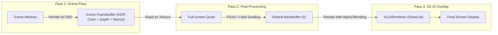

# Architecture: Rendering Pipeline

Bird Engine isolates graphics hardware details behind an abstract pipeline interface (`bird::GraphicsPipeline`), allowing multiple backend implementations.

---

## 1. Graphics Backend Architecture

```
                    +---------------------------+
                    | bird::GraphicsPipeline    |
                    +-------------+-------------+
                                  |
            +---------------------+---------------------+
            |                                           |
+-----------v-----------+                   +-----------v-----------+
|  bird::gl::GLPipeline |                   |  bird::vk::VKPipeline |
|  (OpenGL 4.1 / 4.6)   |                   |  (Vulkan 1.x)         |
+-----------------------+                   +-----------------------+
```

---

## 2. Standard Shading Interfaces

Bird Engine standardizes uniform blocks and push constants across all backends:

### `GlobalUBOData` (Binding 0, std140)
Written once per frame with camera transformations:
```cpp
struct GlobalUBOData {
    Matrix4 perspective; // 4x4 perspective or orthographic matrix
    Matrix4 view;        // Camera::getViewMatrix(): inverse of the camera pose
    Vector4 viewPos;     // Camera eye position in world space
};
```

### `ObjectPushConstants` (std430)
Written per draw call for individual object transformations:
```cpp
struct ObjectPushConstants {
    Matrix4 model;           // 4x4 model transform matrix (T * R * S)
    Vector4 normalMatrix[3]; // inverse-transpose of model's 3x3, as std430 mat3
};
```
The normal matrix is computed on the CPU per draw, so normals stay perpendicular to surfaces under rotation and non-uniform scale (the shader uses `object.normalMatrix * normal`). The block is 112 bytes, inside the 128-byte push-constant minimum.
- In Vulkan, forwarded directly via `vkCmdPushConstants`.
- In OpenGL, emulated through uniform buffer updates or reflected uniform locations.

### `MaterialUBOData` (Binding 1, std140)
Defines surface shading parameters:
```cpp
struct MaterialUBOData {
    Vector4 color;          // Diffuse RGBA
    Vector3 specularColor;  // Specular reflection
    Vector3 ambientColor;   // Ambient contribution
    float shininess;        // Specular exponent
};
```

---

## 3. The OpenGL Three-Pass Pipeline (`GLPipeline`)

The primary OpenGL backend executes a three-phase rendering pass every frame:



### Pass 1: Offscreen Scene Pass
- Binds offscreen `GLFrameBuffer`.
- Enables `GL_DEPTH_TEST`.
- Clears color and depth buffers.
- Binds `GlobalUBOData` with the 3D perspective projection and view matrices.
- Loops through all registered `MeshComponent` instances:
  - Binds mesh material and diffuse textures.
  - Updates `ObjectPushConstants` from `obj->getTransformMatrix()` (model and normal matrix).
  - Binds the mesh VAO (`GLMesh::getVAO()`) and submits `glDrawElements(GL_TRIANGLES, ...)`.

### Pass 2: Post-Processing Pass
- Binds the default window backbuffer (`glBindFramebuffer(GL_FRAMEBUFFER, 0)`).
- Disables depth testing (`glDisable(GL_DEPTH_TEST)`).
- Binds the scene color attachment texture to texture slot 0.
- Binds the post-processing shader (`passthrough.vert` + `fxaa.frag`).
- Renders the shared full-screen quad mesh (`s_quad_mesh`), applying fast approximate anti-aliasing (FXAA).

### Pass 3: 2D UI Overlay Pass
- Retains default backbuffer.
- Re-binds `GlobalUBOData` with an orthographic projection (`m_orthoMatrix`) spanning window coordinates `(0, 0)` to `(width, height)`.
- Binds font atlas texture to slot 0.
- Enables alpha blending:
  ```cpp
  glEnable(GL_BLEND);
  glBlendFunc(GL_SRC_ALPHA, GL_ONE_MINUS_SRC_ALPHA);
  ```
- Submits the aggregated 2D UI geometry via `GLUIRenderer`. Because UI is drawn *after* post-processing, font glyphs and UI borders remain sharp and unaffected by FXAA blur.

---

## 4. Multi-Backend Status

| Feature | OpenGL (`GLPipeline`) | Vulkan (`VKPipeline`) | Metal (`MLPipeline`) | DirectX 12 (`DXPipeline`) |
|---|---|---|---|---|
| **Status** | Full Production | Pipeline & Swapchain Core | Architecture Stub | Architecture Stub |
| **Windowing** | GLFW / X11 / Win32 / Cocoa | GLFW / Volk | Native / Cocoa | Win32 |
| **Shader Source** | Baked `.bird` (GLSL 410/460) | Baked `.bird` (SPIR-V) | SPIR-V to MSL | SPIR-V to HLSL |
| **Post-Processing** | FXAA & FBOs | Subpass / RenderPass | Planned | Planned |
| **2D UI Overlay** | `GLUIRenderer` | `VKDrawList` (Planned) | Planned | Planned |
