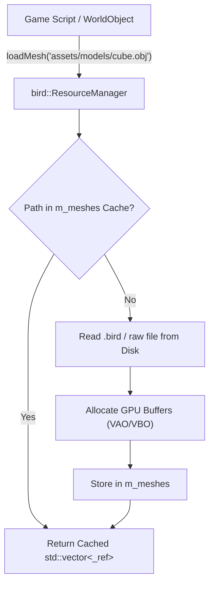

# Architecture: Resource & Asset Management

Bird Engine employs an offline asset baking model combined with a runtime caching system to ensure fast loading times, deterministic builds, and optimal GPU resource usage.

---

## 1. Asset Baking Pipeline (`BuildTools`)

Rather than parsing heavy, unoptimized formats (such as raw text GLSL, TrueType vector outlines, or complex FBX hierarchies) at game startup, Bird Engine processes assets offline into binary `.bird` files.

```mermaid
flowchart TD
    subgraph Raw Assets
        S_GLSL["Shaders (.vert, .frag)"]
        S_FONT["Fonts (.ttf, .otf)"]
        S_MODEL["Models (.obj, .glb, .fbx)"]
    end

    subgraph BuildTools Compiler
        BT["BuildTools (AssetLoader)"]
        SC["shaderc (Vulkan GLSL -> SPIR-V)"]
        SCROSS["SPIRV-Cross (SPIR-V -> GLSL 460 / 410 / ES 300)"]
        STB["stb_truetype (Font Rasterizer)"]
        ASSIMP["Assimp (Model Processor)"]
    end

    subgraph Baked Assets (.bird)
        B_SHADER[".bird Shader (SPIR-V + GLSL 460 + GLSL 410 + GLSL ES 300 + Reflection)"]
        B_FONT[".bird Font (Atlas Texture + Glyph Metrics)"]
        B_MODEL[".bird Mesh & Material"]
    end

    S_GLSL --> BT --> SC --> SCROSS --> B_SHADER
    S_FONT --> BT --> STB --> B_FONT
    S_MODEL --> BT --> ASSIMP --> B_MODEL
```

### Staleness Checking & Incremental Builds
`BuildTools` tracks content hashes (FNV-1a 64-bit) of source files and all transitive `#include` dependencies. If neither the shader source nor any included files have changed, baking is skipped.

---

## 2. The `.bird` Shader Binary Format

A baked shader file (`<name>.<stage>.bird`) packages everything the engine needs into a self-describing binary format:
- **Magic & Version**: Identifies valid `.bird` shader binaries.
- **Stage**: Vertex, fragment, or geometry.
- **Source Hash**: 64-bit hash of source code and dependencies.
- **Variants**:
  - `SPIRV`: Raw bytecode for Vulkan (`VKPipeline`).
  - `GLSL_460`: Modern OpenGL 4.6 shader code with layout bindings.
  - `GLSL_410`: Backward-compatible OpenGL 4.1 shader code (macOS compliant).
  - `GLSL_ES_300`: OpenGL ES 3.0 / WebGL 2 shader code. Bindings are applied at link time, as for 410, and varyings are named by location (`bird_varying_<n>`) because ES 3.0 pairs stages by name.
- **Reflection Metadata**:
  - Uniform blocks (name, binding, size).
  - Push constant block (member offsets, types, sizes).
  - Texture samplers (name, binding slot).
- **Dependency Tree**: All `#include` file paths and their respective hashes.

---

## 3. The Runtime Resource Manager (`bird::ResourceManager`)

At runtime, `bird::ResourceManager` serves as the central hub for accessing loaded assets:



### Supported Asset Loaders:
- **`loadMesh(path)`**: Loads 3D meshes, decomposing multi-mesh models into individual `Mesh` objects.
- **`loadTexture(path)`** / **`loadColorTexture(path)`**: Loads 2D textures with mipmaps; the color variant stores sRGB data (albedo, emissive).
- **`loadShader(vertexPath, fragmentPath)`** / **`loadShader(builder)`**: Links compiled shader stages into a GPU program, cached by the ordered stage list.
- **`loadFont(path)`**: Loads pre-baked font atlases and glyph metric tables.
- **`loadMaterial(path)`**: Deserializes surface optical properties and binds referenced textures.

### Creating Resources: the Two-Tier Convention

Every resource is obtained one of two ways, decided by its origin:

| Origin | Entry point | Returns |
|---|---|---|
| A file on disk | `ResourceManager::load*(path)` | cached `std::shared_ptr` |
| Data made in code | `XBuilder(required...).option().build()` | a new object |

1. **Disk assets load only through `ResourceManager`.** No resource class reads files itself, so every file is decoded once and shared.
2. **Code-made GPU objects use a builder.** Required arguments go in the constructor, optional settings are chainable setters returning the builder, and `build()` creates the object. Builders are the sole place that selects the graphics backend: `TextureBuilder`, `MeshBuilder`, `ShaderBuilder`, `FrameBufferBuilder`, and `BufferBuilder<T, N>`.
3. **Ownership follows sharing.** Shareable resources (`Texture`, `Mesh`, `Shader`) return `std::shared_ptr`; privately owned objects (`FrameBuffer`, `Buffer`) return `std::unique_ptr`.
4. **`Material` is the sole exception.** Materials stay mutable at runtime, are edited from Dart, and need no backend choice, so `Material::create()` plus chainable setters replaces a builder. Material files still load through `loadMaterial`.

Code inside a backend (`src/renders/opengl/`) may construct its own concrete types, such as `GLFrameBuffer`, directly; engine and game code never does.

```cpp
// Tier 1: from disk, cached.
auto albedo = resource_manager()->loadColorTexture("assets/textures/wood.png");
auto shader = resource_manager()->loadShader("assets/shaders/mesh.vert",
                                             "assets/shaders/gbuffer.frag");

// Tier 2: made in code.
auto target = bird::TextureBuilder(width, height, bird::FORMAT_RGBA16F)
                  .clampToEdge()
                  .filterLinear()
                  .build();
auto block = bird::BufferBuilder<MyBlock>(bird::BUFFER_UNIFORM | bird::BUFFER_STAGED)
                 .data(std::move(initial), 1)
                 .bindingPoint(4)
                 .build();
```

`BufferBuilder::build()` uploads uniform buffers immediately and applies their binding point. Vertex and index streams remain CPU-side until the `MeshBuilder` that receives them builds the mesh, because attribute setup requires the mesh's vertex array object.
