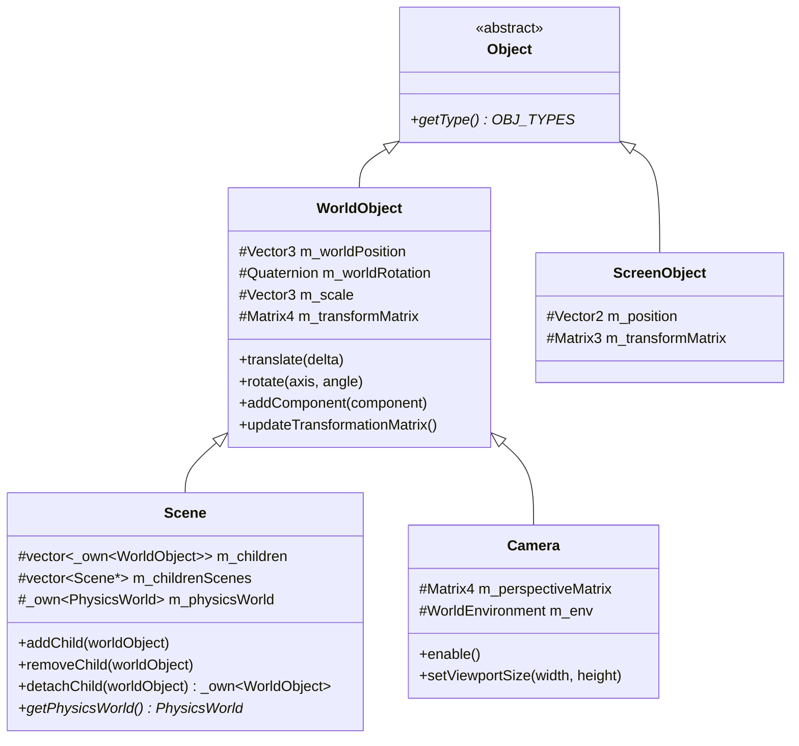

# Architecture: Scene Tree & Scripting

Bird Engine combines a hierarchical scene tree with an Entity-Component System (ECS) architecture, allowing modular composition of visual, physical, and behavioral logic.

---

## 1. Object Type Hierarchy

All entities that participate in the scene tree inherit from `bird::Object`:



### Type Identification (`BIRD_OBJECT`)
To avoid full C++ RTTI overhead while enabling fast type discrimination, Bird Engine provides the `BIRD_OBJECT(TypeName)` macro:
```cpp
enum OBJ_TYPES {
    WORLDOBJECT,
    SCREENOBJECT,
    CAMERA,
    LIGHT,
    SCENE
};

#define BIRD_OBJECT(TypeName) \
public: \
    static constexpr OBJ_TYPES s_type = TypeName; \
    virtual OBJ_TYPES getType() const override { return s_type; }
```

---

## 2. WorldObject & Dirty Matrix Caching

A `WorldObject` manages:
- **Local Transforms**: `localPosition`, `localRotation` (quaternion), and `scale`.
- **World Transforms**: `worldPosition` and `worldRotation`.
- **4x4 Cached Model Matrix**: `m_transformMatrix`.

### Dirty Matrix Optimization
Matrix multiplication (Translation * Rotation * Scale) is expensive when performed repeatedly. Whenever position, rotation, or scale changes via `translate()`, `rotate()`, or setters, `m_needsMatrixUpdate` is set to `true`.
The central application checks `needsMatrixUpdate()` before drawing, recalculating only dirty matrices (and clearing the flag).

The same setters also increment a **transform revision** (`getTransformRevision()`). Systems that mirror the transform, such as physics bodies, compare the revision against the value they last synchronized, so they notice game-side moves without the object knowing about them.

### Lifecycle Order
- `Scene::addChild()` takes ownership and calls `init(scene)`: each component receives `_init()` then `init()`.
- `Scene::removeChild()` calls `deinit()` while the child is still attached (each component receives `deinit()` then `_deinit()`), then destroys it.
- `Scene::detachChild()` deinitializes the same way but hands ownership back, so the object can be added to another scene (a physics body is rebuilt in that scene's world).
- `Scene::deinit()` deinitializes every child first, recursing into sub-scenes.
- `WorldObject::removeComponent()` deinitializes the component only when the object is initialized.

---

## 3. The Component System

Components inherit from `bird::Component` and attach to `WorldObject` entities:
```cpp
class Component {
public:
    virtual void _init();    // Engine-level hook (subsystem registration)
    virtual void _deinit();  // Engine-level hook (subsystem unregistration)
    virtual void init() = 0; // User initialization
    virtual void deinit() = 0;

    WorldObject* world_object();

    template <typename T>
    T* objectAs();           // Safe checked downcast to derived host Object
};
```

### `objectAs<T>()` Downcasting
Components can safely access their host entity as a specific derived type (e.g. `Camera`):
```cpp
Camera* cam = component->objectAs<Camera>();
```
In debug builds, this validates `m_object->getType() == T::s_type` and asserts on mismatch.

---

## 4. Scripting: `Script<T>` vs `ProcessScript<T>`

Bird Engine provides two base templates for game logic:

### 1. `Script<T>` (Setup & State)
Inherits from `ScriptComponent` and provides typed access to the host entity via `object()`, plus helpers for singletons:
- `scene()`: Parent scene.
- `resource_manager()`: Asset cache.
- `input()`: Input subsystem.

Used for one-time initialization, such as scene builders (`Script<Scene>`).

### 2. `ProcessScript<T>` (Per-Frame Ticking)
Inherits from `ProcessScriptComponent`. In its `_init()` hook, it automatically registers with `bird::APPLICATION->addProcessableScript(this)`. 

Every frame, the application invokes:
```cpp
virtual void process(float delta);
```
Used for continuous gameplay logic, physics, player controllers, and animated cameras.
