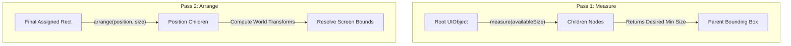
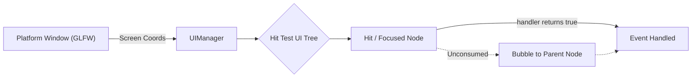

# Architecture: 2D Retained UI Framework

Bird Engine includes a dedicated, graphics-independent 2D user interface framework implemented in `src/scene/2D/`.

---

## 1. Core Design Goals

- **Headless & 100% Unit-Testable**: The entire UI system (input handling, event bubbling, layout algorithms, text editing, and draw batching) runs without any graphics context.
- **Retained-Mode Tree with Declarative API**: Widgets exist as persistent nodes in a tree, with immediate-style configuration and callback wiring.
- **Minimal Draw Calls**: All visible UI elements are batched into one `UIDrawList`. Text and shapes share the font atlas, so a UI without images is a single draw call; each `UIImage` adds a command for its own texture (`UIDrawList::commands()`).
- **Shaped in the Shader**: Rounded corners, borders, soft shadows and anti-aliased lines are signed-distance shapes evaluated per fragment, and clipping is a per-vertex rectangle tested in the fragment shader, so none of them breaks batching.

---

## 2. The Two-Pass Layout Engine

Layout in Bird Engine is divided into two $O(N)$ passes:



### 1. Measure Pass (`measureContent`)
Bottom-up traversal. Each node computes its desired size based on its contents (e.g. text length, padding, or fixed size constraints) and returns the minimum bounding box it requires.

### 2. Arrange Pass (`arrangeChildren`)
Top-down traversal. Parents assign final pixel rectangles to children based on their size rules:
- `UISizeRule::fixed(px)`: Child receives the exact pixel dimension.
- `UISizeRule::fill(weight)`: In a `UIStack`, remaining space is divided among fill children proportionally to their weights.
- `UISizeRule::fit()`: Child receives its measured content size.

---

## 3. The `UIStack` Flexbox Layout

`UIStack` provides linear layouts (horizontal rows or vertical columns):

```
+-------------------------------------------------------------+
| UIStack (Horizontal, Gap: 10px, Align: Center)             |
|                                                             |
| +-----------+  10px  +-----------------------+  10px  +---+ |
| | Label     | <----> | TextBox (fill weight 1)| <----> |Btn| |
| | (fit size)|        |                       |        |   | |
| +-----------+        +-----------------------+        +---+ |
+-------------------------------------------------------------+
```

- **Main Axis Justification (`UIJustify`)**: `Start`, `Center`, `End`, `SpaceBetween`.
- **Cross Axis Alignment (`UIAlign`)**: `Start`, `Center`, `End`, `Stretch`.
- **Gaps & Insets**: Automated pixel gaps between items and uniform or per-edge padding (`UIInsets`).

### Anchors inside stacks
The stack owns the main axis, but a child's **explicitly set** anchors still apply on the cross axis:
- Equal anchors (`setAnchor`) place the child at `anchor * space - pivot * size`, overriding the stack's `align` for that child.
- Unequal anchors (`setAnchors(min, max)`) stretch the child between those fractions of the cross space.
- `setOffset` nudges the child visually without moving its siblings.
- `setLayoutMode(UILayoutMode::Absolute)` takes a child out of the flow entirely: it takes no space and is placed by its anchors inside the stack's content box (badges, overlays).

---

## 4. Input & Event Bubbling

Input events (mouse move, click, scroll, key press, character input) are processed by `bird::UIManager`:



Handlers (`onMouseDown`, `onKey`, `onScroll`, ...) return `true` to consume an event; otherwise it bubbles to the parent.

### Event Priority & Modals:
1. **Popups (`openPopup`)**:
   Dropdown lists, menus and the colour button's picker are light-dismiss popups above modals. Pressing outside every popup closes them all and the press is consumed; Escape closes the top one; keys go to the top popup first. A right click on a node with `setContextMenu(...)` (or on any descendant of it) opens that menu at the cursor.
2. **Modal Stack (`pushModal`)**:
   When a modal (e.g. `UIDialog`) is pushed, all input events below the modal's backdrop are blocked.
3. **Keyboard Focus**:
   When a text box is focused (or a `UIKeyBindField` is waiting for a key), `UIManager::wantsKeyboard()` returns `true`, preventing game camera scripts from capturing typing keys.
4. **Mouse Ownership**:
   When hovering over interactive UI widgets, `UIManager::wantsMouse()` returns `true`, allowing the game to ignore mouse clicks intended for UI buttons.

---

## 5. Available Widget Library

| Widget | Purpose | Key Features |
|---|---|---|
| **`UILabel`** | Single-line text display | Font size, color styling, auto-sizing (`Fit`). |
| **`UIButton`** | Clickable push button | Hover/press/focus states, Enter/Space activation, `setOnClick`. |
| **`UICheckBox`** | Boolean check toggle | Checkmark icon, label, keyboard toggling. |
| **`UIToggle`** | Animated pill switch | Smooth animated knob transition. |
| **`UISlider`** | Continuous / stepped slider | Min/max bounds, step increments, drag capture. |
| **`UIProgressBar`**| Progress indicator | 0.0 to 1.0 filling, optional percentage text. |
| **`UITextBox`** | Single-line text input | Caret blinking, text selection, clipboard copy/paste. |
| **`UITextArea`** | Multi-line text editor | Multi-line navigation, line wrapping, scroll sync. |
| **`UIScrollView`**| Scrollable view container | Vertical scrolling: wheel, draggable scrollbar, track paging. |
| **`UITabView`** | Multi-page tab container | Dynamic tab headers, active page swapping. |
| **`UIWindow`** | Draggable desktop window | Titlebar, close button, resizable frame. |
| **`UIDialog`** | Modal alert / confirmation | Title, message, customizable action buttons. |
| **`UIDropdown`** | Selectable item picker | Popup list (never clipped), type-ahead, scrolls past 8 items. |
| **`UIRadioGroup`** | Mutually exclusive options | Arrow keys move the selection; one Tab stop per group. |
| **`UINumberField`** | Numeric input | Min/max/step/precision, steppers, wheel, drag-to-scrub. |
| **`UIMenuBar`** | Application top menu bar | Cascading submenus, check items, shortcut labels (display only), Left/Right between menus. |
| **`UITooltip`** | Hover hint box | Appears after `tooltipDelaySeconds`, placed near the cursor and kept on screen. |
| **`UIListView`** | Virtualized list | Millions of rows, single/multiple selection. See section 6. |
| **`UITreeView`** | Virtualized tree | Expand/collapse, keyboard navigation, path-based selection. See section 6. |
| **`UIExpander`** | Collapsible section | Header with disclosure triangle; collapsed content takes no space. |
| **`UIColorPicker`** | Full colour editor | Wheel, HSV/RGB/alpha controls, hex input, copy/paste. See section 7. |
| **`UIColorButton`** | Compact colour input | Swatch button opening a `UIColorPicker` popup. |
| **`UIRangeSlider`** | Two-thumb range | Thumbs cannot cross; optional minimum gap and step. See section 8. |
| **`UIKeyBindField`** | Key binding capture | "Press a key" for game controls. See section 8. |
| **`UIImage`** | Texture display | Stretch / Contain / Cover fit, tint, rounded corners. See section 8. |
| **`UISplitter`** | Resizable split panes | Draggable divider, minimum pane size. See section 8. |

---

## 6. Lists and Trees (`UIRowView`)

`UIListView` and `UITreeView` share the `UIRowView` base: fixed-height rows, of which only the ones inside the viewport are built and drawn. Drawing therefore costs O(visible rows) whatever the row count. The base provides the mouse wheel, a draggable scrollbar, track paging, a keyboard cursor (Up/Down, PageUp/PageDown, Home/End), Enter or double-click activation, and type-ahead (typing a letter jumps to the next matching row).

### `UIListView`
- **Items**: `setItems(std::vector<std::string>)`, or `setItemProvider(count, provider)` for large or generated data. The provider is only called for rows that are on screen.
- **Selection** (`setSelectionMode`):
  - `Single`: click or arrows select one row.
  - `Multiple`: Ctrl+click toggles a row, Shift+click and Shift+arrows select a range from the anchor, Ctrl+A selects all, Space toggles the cursor row, Ctrl+arrows move the cursor without changing the selection.
- **Callbacks**: `setOnSelectionChanged()`, `setOnActivate(index)`. Query with `getSelection()` (ascending indices, O(n)), `getSelectedIndex()` or `isSelected(i)`.

### `UITreeView`
- The view **owns** its `UITreeNode` data (`text`, `children`, `expanded`). Only expanded branches contribute rows.
- **Mouse**: click selects; clicking the disclosure triangle, or double-clicking a branch, toggles it; double-clicking a leaf activates it.
- **Keys**: Right expands (or moves into the first child), Left collapses (or moves to the parent), Enter activates.
- **Selection is a path** (`UITreePath`, e.g. `{0, 2}` = third child of the first root). After editing nodes through `getRoots()`, call `refresh()`: the selection is kept where the path still exists and otherwise falls back to the nearest surviving ancestor, never a dangling pointer. `selectPath()` expands the ancestors of its target.

### `UIExpander`
A header with a disclosure triangle above `getContent()`. Collapsing hides the content, so it takes no space and is neither drawn nor hit-tested. Click, Space/Enter, or Left/Right toggle it.

---

## 7. Colour Picker (`UIColorPicker`)

```
+--------------------+--+--+  +-----------------+
|                    |  |  |  | original | new  |   swatch (click left half to revert)
|   hue/saturation   |V |A |  +-----------------+
|       wheel        |  |  |  Hex [#0080FF    ]
|                    |  |  |  [Copy] [Paste]
+--------------------+--+--+
 H [  210] S [  100] V [  100]          numeric fields
 R [    0] G [  128] B [  255] A [100]
 R ==========[]=================        gradient channel sliders
 G ====================[]=======
 B =============================[]
```

- **One colour, many editors.** The colour is held as HSV plus alpha. Every control edits it and every other control updates at once. Holding HSV means hue survives greys and black: dragging a blue down to black and back up returns to blue.
- **Wheel**: hue runs around the circle (0 degrees, red, at the right, increasing counter-clockwise) and saturation from the centre to the rim. It is drawn at full value; value has its own bar. Keys: Left/Right change hue, Up/Down saturation, Shift for larger steps.
- **Value and alpha bars**: vertical gradient sliders; the alpha track sits over a checkerboard.
- **R, G, B sliders**: each track shows that channel's range given the other two.
- **Numeric fields**: H 0-360, S and V 0-100 %, R, G, B 0-255, A 0-100 %. Type, use arrows or the wheel, or drag the steppers.
- **Hex**: accepts `#RGB`, `#RGBA`, `#RRGGBB` and `#RRGGBBAA` (the `#` is optional, case-insensitive). It applies live once valid, Enter normalizes it, and invalid input is reported in the status line. **Copy** puts `#RRGGBB` (or `#RRGGBBAA` when not opaque) on the clipboard; **Paste** applies a hex code from the clipboard.
- **API**: `setColor()` (does not notify, and sets the swatch's original), `getColor()`, `getHSV()`, `getHex()`, `setHex()`, `setOnChanged()`. The conversions are also available on their own in `UIColor.h` (`color::hsvToRgb`, `rgbToHsv`, `toHex`, `parseHex`).
- **`UIColorButton`** is the compact form: a swatch button that opens the picker in a popup and reports changes live through `setOnColorChanged()`.

---

## 8. Rich Inputs

| Widget | Behaviour |
|---|---|
| **`UIRangeSlider`** | A press grabs the nearer thumb, which becomes the keyboard-active one. Thumbs cannot cross and stay at least `setMinGap()` apart. Left/Right step the active thumb, Home/End send it to its limit, Space switches thumbs. `setOnChanged(low, high)`. |
| **`UIKeyBindField`** | Click, Enter or Space starts capturing; the next key press of any kind (including Tab and modifiers) becomes the binding, stored as the raw platform key code (`GLFW_KEY_*`). Escape cancels, Backspace/Delete clears to `kUnbound`, clicking elsewhere cancels. While capturing it owns the keyboard, so the key does not also trigger game actions. Names come from `UIPlatform::keyName()` ("W", "Space", "F5"). |
| **`UIImage`** | Shows a `Texture` with `UIImageFit::Stretch`, `Contain` (letterboxed) or `Cover` (cropped through the UVs), plus `setTint()` and `setCornerRadius()`. Its natural size is the texture's pixel size. |
| **`UISplitter`** | Two panes, `getFirst()` and `getSecond()`, separated by a divider. Drag to resize; each pane keeps at least `setMinPaneSize()`; double-click the divider to restore the initial ratio. Panes clip their children. |
