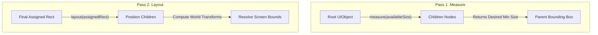

# Architecture: 2D Retained UI Framework

Bird Engine includes a dedicated, graphics-independent 2D user interface framework implemented in `src/scene/2D/`.

---

## 1. Core Design Goals

- **Headless & 100% Unit-Testable**: The entire UI system (input handling, event bubbling, layout algorithms, text editing, and draw batching) runs without any graphics context.
- **Retained-Mode Tree with Declarative API**: Widgets exist as persistent nodes in a tree, with immediate-style configuration and callback wiring.
- **Single-Draw-Call Batching**: All visible UI elements (panels, text, sliders, buttons) are batched into a single `UIDrawList` sharing a unified font/texture atlas.

---

## 2. The Two-Pass Layout Engine

Layout in Bird Engine is divided into two $O(N)$ passes:



### 1. Measure Pass (`measureContent`)
Bottom-up traversal. Each node computes its desired size based on its contents (e.g. text length, padding, or fixed size constraints) and returns the minimum bounding box it requires.

### 2. Layout Pass (`layout`)
Top-down traversal. Parents assign final pixel rectangles to children based on their size rules:
- `UISizeRule::fixed(px)`: Child receives the exact pixel dimension.
- `UISizeRule::fill(weight)`: In a `UIStack`, remaining space is divided among fill children proportionally to their weights.
- `UISizeRule::fit()`: Child receives its measured content size.

---

## 3. The `UIStack` Flexbox Layout

`UIStack` provides linear layouts (horizontal rows or vertical columns):

```
+-------------------------------------------------------------+
| UIStack (Horizontal, Gap: 10px, Align: Center)             |
|                                                             |
| +-----------+  10px  +-----------------------+  10px  +---+ |
| | Label     | <----> | TextBox (fill weight 1)| <----> |Btn| |
| | (fit size)|        |                       |        |   | |
| +-----------+        +-----------------------+        +---+ |
+-------------------------------------------------------------+
```

- **Main Axis Justification (`UIJustify`)**: `Start`, `Center`, `End`, `SpaceBetween`.
- **Cross Axis Alignment (`UIAlign`)**: `Start`, `Center`, `End`, `Stretch`.
- **Gaps & Insets**: Automated pixel gaps between items and uniform or per-edge padding (`UIInsets`).

---

## 4. Input & Event Bubbling

Input events (mouse move, click, scroll, key press, character input) are processed by `bird::UIManager`:


### Event Priority & Modals:
1. **Modal Stack (`pushModal`)**:
   When a modal (e.g. `UIDialog`) is pushed, all input events below the modal's backdrop are blocked.
2. **Keyboard Focus**:
   When a text box is focused, `UIManager::wantsKeyboard()` returns `true`, preventing game camera scripts from capturing typing keys.
3. **Mouse Ownership**:
   When hovering over interactive UI widgets, `UIManager::wantsMouse()` returns `true`, allowing the game to ignore mouse clicks intended for UI buttons.

---

## 5. Available Widget Library

| Widget | Purpose | Key Features |
|---|---|---|
| **`UILabel`** | Single-line text display | Font size, color styling, auto-sizing (`Fit`). |
| **`UIButton`** | Clickable push button | Click sound hook, hover/press states, keyboard activation. |
| **`UICheckBox`** | Boolean check toggle | Checkmark icon, label, keyboard toggling. |
| **`UIToggle`** | Animated pill switch | Smooth animated knob transition. |
| **`UISlider`** | Continuous / stepped slider | Min/max bounds, step increments, drag capture. |
| **`UIProgressBar`**| Progress indicator | 0.0 to 1.0 filling, optional percentage text. |
| **`UITextBox`** | Single-line text input | Caret blinking, text selection, clipboard copy/paste. |
| **`UITextArea`** | Multi-line text editor | Multi-line navigation, line wrapping, scroll sync. |
| **`UIScrollView`**| Scrollable view container | Vertical/horizontal scrollbars, mouse wheel scrolling. |
| **`UITabView`** | Multi-page tab container | Dynamic tab headers, active page swapping. |
| **`UIWindow`** | Draggable desktop window | Titlebar, close button, resizable frame. |
| **`UIDialog`** | Modal alert / confirmation | Title, message, customizable action buttons. |
| **`UIDropdown`** | Selectable item picker | Popover menu list, selected item display. |
| **`UIMenuBar`** | Application top menu bar | Cascading menus, keyboard accelerators. |
| **`UITooltip`** | Hover hint box | Delayed appearance, cursor proximity follow. |
